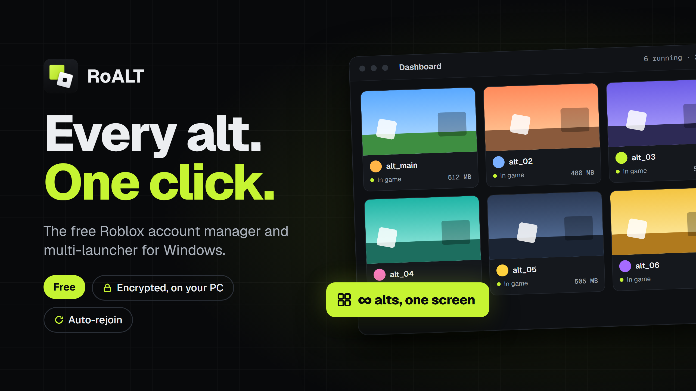
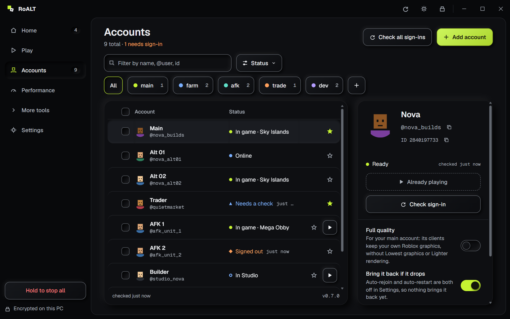
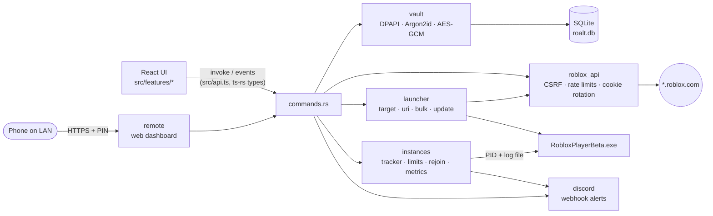

<div align="center">



# RoALT

### Every Roblox account you own, signed in, checked and one click from any game.

A fast, local-only account manager and multi-client launcher for Windows.<br>
Your cookies stay encrypted on your PC. Nothing is sent anywhere except Roblox.

[](https://github.com/inspectsoftware/RoALT/releases/latest)
[](https://github.com/inspectsoftware/RoALT/releases)
[](#-install)
[](https://discord.gg/Q2vrgDKb3)

[](https://github.com/inspectsoftware/RoALT/actions/workflows/ci.yml)


<br>

[**⬇ Download**](https://github.com/inspectsoftware/RoALT/releases/latest) &nbsp;·&nbsp;
[**💬 Discord**](https://discord.gg/Q2vrgDKb3) &nbsp;·&nbsp;
[Quick start](#-quick-start) &nbsp;·&nbsp;
[Privacy](#-safety-and-privacy) &nbsp;·&nbsp;
[For developers](#-for-developers)

<br>



</div>

<br>

## 📑 Contents

| For everyone | For developers |
|---|---|
| [What is RoALT?](#-what-is-roalt) | [Architecture](#-architecture) |
| [Features](#-features) | [Tech stack](#-tech-stack) |
| [Install](#-install) | [Build from source](#-build-from-source) |
| [Quick start](#-quick-start) | [Project layout](#-project-layout) |
| [Safety and privacy](#-safety-and-privacy) | [Testing](#-testing) |
| [FAQ](#-faq) | [Contributing](#-contributing) |
| [Community](#-community) | [Cut a release](#-cut-a-release) |

<br>

## 💡 What is RoALT?

If you play Roblox on more than one account, you know the routine: sign out, sign in, find the game again,
and only ever one client open at a time. RoALT removes all of that.

- **Add each account once**, through Roblox's own sign-in page. RoALT keeps it signed in.
- **See every account at a glance**: online status, Robux, friends, whether the sign-in still works.
- **Paste any game link** and launch one account, or ten, into it. Even into the same server.
- **Run several Roblox windows side by side**, and let RoALT bring back any that crash or get kicked.

It runs entirely on your PC. There is no RoALT account, no RoALT server and no tracking.

<br>

## ✨ Features

<table>
<tr>
<td width="50%" valign="top">

### 🔐 Encrypted vault
Cookies are encrypted with **Windows DPAPI**, or with your own **master password** (Argon2id + AES-256-GCM)
with auto-lock. Reveal and copy sit behind **Windows Hello** or the master password.

</td>
<td width="50%" valign="top">

### 👥 Accounts at a glance
Avatars, live presence, Robux, Plus, friends, followers and 2-step status. Groups, aliases, notes,
favourites, search and filters. Validate one or all in a click.

</td>
</tr>
<tr>
<td valign="top">

### 🚀 Launch anything
Paste a game link, place ID, job ID, private server or share link, a profile or `@username`:
RoALT works out what it is. Join a friend, or save a target as a favourite.

</td>
<td valign="top">

### 🪟 Multi-instance
Run several clients side by side. Launch a batch one after another, all into **the same server**
if you like, with live progress per account.

</td>
</tr>
<tr>
<td valign="top">

### 🔁 Auto-rejoin and restart
A disconnected client rejoins the same game on its own. Opt-in: crashed, frozen or memory-hungry
clients restart too. A crash breaker gives up on an account after too many tries.

</td>
<td valign="top">

### 🗺️ Server browser
Browse public servers by players or ping, see your private servers, and send any accounts into
the one you pick.

</td>
</tr>
<tr>
<td valign="top">

### 📈 Monitor
CPU, memory, disk/network and uptime per client, with sparklines and totals, refreshed every 2 seconds.

</td>
<td valign="top">

### 🎚️ Performance tools
Cap one client's CPU (down to 5%), use efficiency mode, pin cores or trim memory. An adaptive mode
limits every client that isn't in front. Opt-in upload limit for all clients.

</td>
</tr>
<tr>
<td valign="top">

### 🔔 Discord alerts
Crashes, disconnects, restarts and finished batches posted to **your own** webhook, kept encrypted
in the vault. Opt-in.

</td>
<td valign="top">

### ⬆️ Roblox updates
Shows when Roblox is out of date and installs the update with Roblox's own installer, after checking
it is signed by Roblox Corporation. Optional auto-update when no client runs.

</td>
</tr>
<tr>
<td valign="top">

### 🖥️ Dashboard
Every running client as a live window thumbnail. Right-click one to focus, minimize, shrink it to a
micro window, limit it or close it. Tile all clients in a grid in one click.

</td>
<td valign="top">

### 📱 LAN web dashboard
Opt-in. Open RoALT from your phone on the same network: see running clients, close them, Kill all or
launch accounts, signed in with an 8-digit PIN, over HTTPS.

### 🛡️ Public networks
On a network Windows calls **Public** (café, hotel, school Wi-Fi), RoALT doesn't launch or run the web dashboard, and a
master-password vault locks. You can allow public networks in Settings, Security, after a warning.

</td>
</tr>
</table>

<details>
<summary><b>All features, in detail</b></summary>
<br>

| Area | What you get |
|---|---|
| 🔐 **Vault** | DPAPI by default (opens silently). Optional master password with auto-lock after idle. Encrypted `.roalt` backups you can export and import. Copied cookies are kept out of clipboard history and cleared after 30 s. |
| 👥 **Accounts** | Add through Roblox's sign-in page (passkeys and security keys work), by pasting a cookie, by pasting many cookies at once, or by importing from Roblox Account Manager (an unlocked `AccountData.json`). Groups, alias, notes, colour, favourite, drag to reorder. Presence, Robux, Plus / Premium (legacy), friend and follower counts, join date, email and 2-step status. "Open on roblox.com" signed in as that account. |
| 🚀 **Launch** | Game links, place IDs, `roblox://` links, job IDs, private server links, `roblox.com/share` links (both formats), universes, profiles, `@username`. Join a friend or one of your other accounts. Favourites in the sidebar and tray. `Ctrl+Enter` to launch. |
| 🪟 **Batches** | Accounts launch strictly one after another with a stagger (default 6 s). **Same server**: *Pick a server* finds one with room for everyone first; *Follow the first* sends the rest to wherever the first account landed. Cancel at any time; one click re-picks the accounts that didn't launch. |
| 🔁 **Recovery** | Auto-rejoin after kicks, shutdowns and lost connections (not after you leave on purpose). Opt-in auto-restart for crashes, frozen windows (30 s) and a memory limit. Crash breaker: default 3 relaunches in 10 minutes, with growing backoff. Per-account "Allow disconnect". Crash history with the log's reason. |
| 🖥️ **Dashboard** | Live preview per client at 15, 30 or 60 FPS (your pick, while RoALT is on screen), with state, game, uptime, CPU and RAM. Right-click, the menu key or `Shift+F10` for focus, minimize, restore, micro window (320×240) and back, CPU limit, efficiency mode, anti-AFK, close. **Tile** fits all clients in a grid on the screen; **Tile micro** lays out micro windows. Minimize all, Restore all. |
| 🛑 **Kill all** | Hold one button in the sidebar, use the tray, or press a global **panic hotkey** you choose (off by default) to end every Roblox process and stop pending launches and rejoins. |
| ⏲️ **Automation** | Minimize each new client on launch. Auto-shutdown timer: close the clients and shut the PC down at a set time (survives a RoALT restart, can be cancelled). Hourly Roblox log cleaner (logs older than a day or over 50 MB). Open logs button; RoALT's own logs rotate at 5 MB. |
| ⚙️ **Launch control** | Custom launch arguments (default and per account, checked before use and never logged), a cooldown between launches, a configurable close grace (1–60 s). |
| 🎚️ **Limits** | Per client: CPU cap, efficiency mode, core affinity, working-set trim (every N minutes or "Trim now"). Adaptive manager for background clients; your manual limits always win. **Memory throttle**: a client over a RAM limit gets a CPU cap, which lowers its frame rate, until it drops under 90 % of the limit. |
| 🎞️ **FPS cap** | A default frame-rate cap (5–360), a per-account override and a per-launch one in Launch (a rejoin keeps it), written to Roblox's `ClientAppSettings.json` just before each launch and put back a few seconds later. Skipped when a bootstrapper such as Bloxstrap manages Roblox. |
| 📶 **Bandwidth** | One upload cap for all Roblox clients through a Windows QoS policy. Applied only when you click Apply (admin prompt); cleared when Windows restarts. |
| 💤 **Anti-AFK** | Off by default. While you are away from the PC, every few minutes each client is briefly brought to the front and gets one Space press, so Roblox doesn't kick it after 20 idle minutes. Stops the moment you touch the mouse. Or **in the background**: a Tab press is posted to the window without bringing it to the front, even when minimized (Roblox may not count it in every game; auto-rejoin stays the fallback). Per-client opt-out. |
| 🔔 **Discord** | Crash, disconnect, restart and batch alerts, plus an opt-in alert when a client gets into a game. Mute alerts per account. **Rich presence** (on by default, a switch in Settings): your profile shows "Playing RoALT", idling or with the game and how many alts run. |
| 📱 **Web dashboard** | Opt-in, off by default. A small page on your PC's LAN address: running clients with Close and Force, Kill all, and launch ticked accounts into a pasted link. 8-digit PIN, 30-day sign-in, rate-limited. |
| 🔄 **RoALT updates** | Looks for a new RoALT on GitHub Releases at start and every 6 hours (can be turned off; *Check now* in Settings). A banner offers it; *Update now* downloads it, checks its release signature, installs it silently and restarts RoALT. Never installs on its own. |
| 🧰 **Comfort** | Tray menu with favourites, close to tray, relaunch an ended client in one click, movable data folder, keyboard shortcuts. Dark, light or system theme, any accent colour, and your own background image. |

</details>

<br>

## 📥 Install

1. Download **`RoALT-Setup-<version>.exe`** from the [latest release](https://github.com/inspectsoftware/RoALT/releases/latest).
2. Run it. No admin rights needed; it installs to `%LOCALAPPDATA%\Programs\RoALT`.
3. Start RoALT from the Start menu or the desktop icon.

| Requirement | |
|---|---|
| Windows | 10 (1809 or later) or 11, x64 |
| WebView2 Runtime | Built into Windows 11. Setup offers to download it when missing. |
| Roblox | Installed normally (RoALT can install or update it for you) |

> [!NOTE]
> The installer isn't code-signed yet, so Windows SmartScreen warns on first run. To be sure the file is genuine,
> compare its SHA-256 with `SHA256SUMS.txt` on the release page, then choose **More info → Run anyway**.
>
> ```powershell
> Get-FileHash .\RoALT-Setup-0.6.5.exe -Algorithm SHA256
> ```

Your accounts and settings live in `%LOCALAPPDATA%\RoALT`. Uninstalling keeps them unless you tick
**"also delete my data"**.

<br>

## 🏁 Quick start

<details open>
<summary><b>1. Add your first account</b></summary>
<br>

Press **Add account** (or `Ctrl+N`). A clean Roblox sign-in window opens: sign in as usual, including 2-step or
passkeys. RoALT keeps the sign-in, closes the window and throws its browser profile away. You can also paste a
`.ROBLOSECURITY` cookie; it is checked before it is saved.

</details>

<details>
<summary><b>2. (Optional) Set a master password</b></summary>
<br>

By default the vault is locked to your Windows account, so it opens silently. For extra protection, set a master
password in **Settings**. RoALT then asks for it on start and locks itself after you've been idle.

</details>

<details>
<summary><b>3. Launch a game</b></summary>
<br>

Go to **Launch** (`Ctrl+3`), paste a game link, tick an account and press **Launch** (`Ctrl+Enter`).
Tick several accounts to launch a batch. Turn on **Same server** to put them all in one server.

</details>

<details>
<summary><b>4. Run several clients at once</b></summary>
<br>

**Multi-instance** is on by default (the switch is in the sidebar); start RoALT before Roblox. If Roblox is already open, RoALT says so and offers
**Close Roblox** or **Take over**. Every client RoALT starts shows up under Running and on the **Dashboard**
(`Ctrl+1`), with its state, server and uptime.

</details>

<details>
<summary><b>5. Let it look after your clients</b></summary>
<br>

In **Settings → Launching**, turn on **Auto-rejoin** (and, if you like, **Auto-restart**). Open **Monitor**
(`Ctrl+6`) to see what each client uses, and **Discord** (`Ctrl+7`) to get alerts on your phone.

</details>

<details>
<summary><b>⌨️ Keyboard shortcuts</b></summary>
<br>

| Keys | Action |
|---|---|
| `Ctrl+1` … `Ctrl+7` | Dashboard, Accounts, Launch, Servers, Settings, Monitor, Discord |
| `Ctrl+N` | Add account |
| `Ctrl+F` | Search accounts |
| `Ctrl+Enter` | Launch |
| `F5` | Refresh |

</details>

<br>

## 🔒 Safety and privacy

<table>
<tr>
<td width="50%" valign="top">

#### ✅ What RoALT does

- Talks **only** to `*.roblox.com` and `*.rbxcdn.com`, plus GitHub to look for RoALT updates (can be turned off), your Discord webhook, and your LAN if you turn on the web dashboard.
- Encrypts every cookie with **AES-256-GCM** under a key protected by **Windows DPAPI**, plus your master password if you set one.
- Encrypts the **whole database** too (SQLCipher, AES-256), with its own DPAPI-protected key: a copied `roalt.db` can't be read on another PC or Windows account.
- Signs you in through **Roblox's own page**, in a throw-away browser profile.
- Installs Roblox updates **only** when the installer is signed by Roblox Corporation.
- Updates itself **only** when you click Update now, and only with an installer that carries RoALT's release signature.
- Redacts launch tickets from anything it reads in Roblox's logs.

</td>
<td width="50%" valign="top">

#### 🚫 What RoALT never does

- **Never** reads or writes the Roblox client's memory or files, except the opt-in FPS cap in `ClientAppSettings.json`.
- **Never** sends telemetry. There is no RoALT server and no RoALT account.
- **Never** writes cookies, tickets or launch arguments to its logs.
- **Never** changes Windows settings, except the opt-in bandwidth limit.
- **Never** contacts Discord's servers unless you paste a webhook. Rich presence goes only to the Discord app on your PC.

</td>
</tr>
</table>

<details>
<summary><b>The details</b></summary>
<br>

- **Discord rich presence (on by default).** RoALT tells the Discord app on this PC, over its local pipe, the game's
  name and how many clients run. Discord shows that on your profile. Turn it off under **Settings → Show on Discord**.
- **Discord alerts (opt-in).** If you paste a webhook in the Discord tab, alerts go to that webhook on `discord.com`. The URL is
  kept encrypted in the vault, and messages name accounts by display name and username only, with mentions disabled.
  Nothing is sent while the vault is locked.
- **Roblox updates** come from Roblox only: the version from `clientsettingscdn.roblox.com`, the installer from
  `setup.rbxcdn.com`, run only when its signature checks out as Roblox Corporation's.
- **RoALT updates** are looked up on GitHub (`api.github.com`, this repository's latest published release) as soon
  as RoALT starts and every 6 hours, unless you turn *Check for RoALT updates* off in Settings. The request carries only
  `RoALT/<version>` as its user agent. When you click Update now, the installer and its `.sig` are downloaded from
  `github.com` (GitHub's own download hosts only), and the installer runs only if its ECDSA P-256 signature checks out
  against the public key built into RoALT. The signature covers the version too, so the release must be newer than
  the RoALT you run and the installer must be the one signed for that version. It installs silently, and RoALT starts again.
  Roblox clients keep running through it, but the restarted RoALT doesn't track them.
- **Multi-instance** works by creating one named Windows object before Roblox starts. RoALT also holds Roblox's shared
  sign-in files while its clients run, so clients can't sign each other out.
- **Limits** go through Windows itself (job objects, priority, affinity). RoALT only ever opens a client with the
  narrow rights a change needs, never to read its memory.
- **Take over (on request)** closes the one "Roblox is already running" lock inside an open Roblox, so RoALT's clients
  can run next to it. It needs to copy that one handle (`PROCESS_DUP_HANDLE`) and never reads or writes the client's memory.
- **Anti-AFK (opt-in)** briefly brings a client to the front and presses Space the way a keyboard does, or, in background
  mode, posts a Tab press to its window.
- **Window tools** (thumbnails, minimize, micro, tile) use ordinary Windows window calls (`PrintWindow`, `ShowWindow`,
  `SetWindowPos`).
- **Web dashboard (opt-in)** listens on your LAN only while turned on, the vault is unlocked and the network isn't
  Public. It serves **HTTPS only**, with a certificate RoALT makes itself: the browser warns once, so check that the
  certificate's SHA-256 fingerprint matches the one in Settings. The PIN and the certificate's key are kept encrypted,
  sessions use a Secure HttpOnly cookie, every POST needs a custom header, wrong PINs are rate-limited, and requests by
  host name are refused (open it by IP). It returns names, states and usage only, never a cookie or webhook.
- **Bandwidth limit (opt-in)** adds a Windows QoS policy named `RoALT-Roblox` through an admin prompt, only when you click
  Apply. Windows drops it on restart. It is the only change RoALT makes to Windows.

</details>

> [!IMPORTANT]
> Your `.ROBLOSECURITY` cookie is the key to your account. RoALT keeps it encrypted, but never share a cookie,
> a `.roalt` backup or its password with anyone, including people who say they are helping you.

<br>

## ❓ FAQ

<details>
<summary><b>Is RoALT safe to use with my account?</b></summary>
<br>

RoALT signs in the same way the Roblox website does and never touches the Roblox client. Roblox has said that
multi-instance methods which don't modify the client are not affected by its modified-client enforcement, but it
doesn't officially support running several clients at once. Use RoALT only with accounts you own.

</details>

<details>
<summary><b>Why does Windows warn me when I run the installer?</b></summary>
<br>

The installer isn't code-signed yet, so SmartScreen doesn't recognise it. Check the SHA-256 against
`SHA256SUMS.txt` on the release, then choose **More info → Run anyway**.

</details>

<details>
<summary><b>Multi-instance says Roblox is already running.</b></summary>
<br>

Roblox's tray app or an open client already holds the lock RoALT needs. Click **Close Roblox** when RoALT offers it, then
launch from RoALT. To keep that client open, click **Take over** instead.

</details>

<details>
<summary><b>An account shows "Cookie expired" or needs verification.</b></summary>
<br>

Roblox ended that sign-in, or wants a human check. Open the account on roblox.com from its menu and complete the
check, or remove it and add it again.

</details>

<details>
<summary><b>I forgot my master password.</b></summary>
<br>

It can't be recovered: that is what makes it safe. Remove the data folder (`%LOCALAPPDATA%\RoALT`) and add your
accounts again, or import a `.roalt` backup whose password you know.

</details>

<details>
<summary><b>Does it work with Bloxstrap?</b></summary>
<br>

Yes. RoALT launches through the registered bootstrapper and follows its clients. It won't install Roblox updates over a
bootstrapper, since the bootstrapper keeps Roblox up to date itself.

</details>

<details>
<summary><b>Where is my data? Can I move it?</b></summary>
<br>

In `%LOCALAPPDATA%\RoALT`. **Settings → Data** opens it or moves it to another folder or drive.

</details>

<br>

## 💬 Community

Questions, ideas or bug reports? Join the **[Discord server](https://discord.gg/Q2vrgDKb3)** or
[open an issue](https://github.com/inspectsoftware/RoALT/issues).

<br>

---

<div align="center">

# 🔧 For developers

</div>

## 🧭 Architecture

RoALT is a [Tauri 2](https://tauri.app) app: a Rust backend that owns every secret, process and network call, and a
React UI that talks to it over typed IPC. The UI never sees a cookie unless you reveal one.



| Module | Role |
|---|---|
| [`vault/`](src-tauri/src/vault) | Envelope encryption: one random data key encrypts every secret (AES-256-GCM, row-bound AAD). The key is wrapped with DPAPI, or with an Argon2id key from the master password and then DPAPI. Windows Hello re-auth, `.roalt` backups. |
| [`roblox_api/`](src-tauri/src/roblox_api) | The one typed Roblox client. Every URL in `endpoints.rs`. CSRF from the real request's 403, per-route queues driven by `x-ratelimit-*`, rotated `.ROBLOSECURITY` saved atomically, three error-body shapes parsed. |
| [`launcher/`](src-tauri/src/launcher) | `target.rs` parses any pasted link locally; `uri.rs` builds the `roblox-player:` URI exactly like the website; `bulk.rs` runs batches and same-server; `fps.rs` the FPS cap; `update.rs` + `authenticode.rs` install Roblox updates after `WinVerifyTrust`. |
| [`instances/`](src-tauri/src/instances) | `tracker.rs` ties each client to its account by PID, start time and log file; `logwatch.rs` reads job IDs and disconnects; `rejoin.rs` and the crash breaker; `limits.rs` CPU caps, affinity, efficiency mode, trims; `metrics.rs`; `multi.rs` the singleton lock and take-over; `window.rs` thumbnails, micro and tile; `qos.rs`; `afk.rs`. |
| [`discord.rs`](src-tauri/src/discord.rs) | Webhook alerts: host-checked URL, events coalesced every 2 s, `retry_after` honoured. |
| [`remote.rs`](src-tauri/src/remote.rs) | Opt-in LAN web dashboard (axum, HTTPS with a self-signed certificate): PIN login, session cookie, CSRF header, rate limit, Host check, one embedded page (`remote.html`). |
| [`webview.rs`](src-tauri/src/webview.rs) | Sign-in and session windows on temporary WebView2 profiles, deleted after use. |
| [`storage/`](src-tauri/src/storage) | SQLite through `rusqlite` with numbered migrations. Running clients live in memory only. |

<details>
<summary><b>How a launch works</b></summary>
<br>

1. Validate the account, then resolve a share link or universe with **that account's** cookie.
2. `GET auth.roblox.com/v1/client-assertion/`, then POST `authentication-ticket` with it, as the website does.
3. Build the `roblox-player:` URI with a fresh `browsertrackerid`, then start the client from the path in
   `HKCU\Software\ROBLOX Corporation\Environments\roblox-player`.
4. Record the PID and creation time and close the process handle at once.
5. Bind the client's `_Player_` log by that tracker ID, then read its job ID, user ID and disconnects. If Roblox
   relaunches itself during an update, the tracker re-binds through the log's `userid:`.

</details>

<details>
<summary><b>Process-handle rules</b></summary>
<br>

Every sample or change opens a short-lived handle checked against the client's start time, with only the right it
needs: `PROCESS_QUERY_LIMITED_INFORMATION` for metrics, `PROCESS_SET_QUOTA` for trims, `PROCESS_SET_INFORMATION` for
affinity and efficiency mode. Never `PROCESS_VM_READ`; `PROCESS_DUP_HANDLE` only for a take-over you start. Only the
CPU-cap job handle is kept.

</details>

The full design, with every Roblox behaviour verified and its source, is in [docs/DESIGN.md](docs/DESIGN.md).
What each milestone added and how to test it is in [docs/MILESTONES.md](docs/MILESTONES.md).

<br>

## 🧱 Tech stack

| Layer | Tools |
|---|---|
| Shell | Tauri 2.12, WebView2 |
| Backend | Rust (edition 2024), tokio, reqwest (rustls), rusqlite + rusqlite_migration, `windows` 0.62 |
| Crypto | aes-gcm, argon2, zeroize, Windows DPAPI and Windows Hello |
| Frontend | React 19, TypeScript, Vite, Tailwind CSS 4, TanStack Query 5 |
| IPC types | [ts-rs](https://github.com/Aleph-Alpha/ts-rs): Rust types exported to `src/bindings/` |
| Installer | Inno Setup 6.6, GitHub Actions (CI and tagged draft releases) |

<br>

## 🔨 Build from source

**Needs:** Node.js 24, Rust (stable, with the Visual Studio Build Tools' C++ workload) and, for the installer,
[Inno Setup 6.6 or newer](https://jrsoftware.org/isdl.php).

```powershell
git clone https://github.com/inspectsoftware/RoALT.git
cd RoALT
npm ci
npm run tauri dev        # run the app with hot reload
```

| Command | What it does |
|---|---|
| `npm run tauri dev` | Runs the full app. |
| `npm run dev` | Runs the UI alone in a browser, against a built-in mock of the backend (`src/dev/mockIpc.ts`). |
| `npm run build` | Type-checks and builds the UI into `dist/`. |
| `npm run bindings` | Regenerates the TypeScript types in `src/bindings/` from the Rust types. Run it after changing a `#[ts(export)]` type. |
| `powershell -ExecutionPolicy Bypass -File scripts\build-installer.ps1` | Release build plus installer: `dist-installer\RoALT-Setup-<version>.exe` and its SHA-256. |
| `…\build-installer.ps1 -Dev` | Also keeps `installers\RoALT-Setup-<version>-dev-<stamp>.exe`, one per change. |

> [!TIP]
> Set `ROALT_DATA_DIR` to a scratch folder to run a build without touching your real accounts.

<br>

## 📁 Project layout

```text
├─ src/                    React UI
│  ├─ App.tsx              window shell, navigation, shortcuts
│  ├─ api.ts               one typed wrapper per backend command
│  ├─ bindings/            ts-rs generated types (committed)
│  ├─ dev/mockIpc.ts       mock backend for `npm run dev`
│  ├─ ui/                  shared components
│  └─ features/            dashboard · accounts · launch · servers · monitor · discord · settings · vault
├─ src-tauri/              Rust backend
│  ├─ src/
│  │  ├─ main.rs           builder, plugins, managed state
│  │  ├─ commands.rs       IPC layer
│  │  ├─ model.rs          shared types (exported to TS)
│  │  ├─ vault/  roblox_api/  launcher/  instances/  storage/
│  │  ├─ discord.rs  remote.rs  webview.rs  tray.rs  error.rs
│  ├─ tests/fixtures/      recorded Roblox responses (no real cookies)
│  └─ tauri.conf.json
├─ installer/RoALT.iss     Inno Setup script
├─ scripts/                build-installer.ps1
├─ docs/                   DESIGN.md · MILESTONES.md · research/
└─ .github/workflows/      ci.yml · release.yml
```

<br>

## 🧪 Testing

```powershell
npm run typecheck                              # TypeScript
cd src-tauri
cargo test --locked                            # Rust unit tests
cargo clippy --all-targets --locked -- -D warnings
```

The Rust tests cover link parsing, URI building (byte-for-byte against the website's output), vault and backup
round-trips, and response parsing from recorded fixtures. They never use real cookies. CI runs all of the above on
`windows-latest` for every push and pull request.

<br>

## 🤝 Contributing

Bug reports, ideas and pull requests are welcome.

1. Open an [issue](https://github.com/inspectsoftware/RoALT/issues) or ask on [Discord](https://discord.gg/Q2vrgDKb3) first for anything big.
2. Keep changes small and focused, and match the surrounding code.
3. Run the [tests](#-testing) and `npm run bindings` if you changed a shared type.
4. Never commit a real cookie, ticket or webhook, including in fixtures or screenshots.

<br>

## 📦 Cut a release

<details>
<summary><b>Steps</b></summary>
<br>

1. Set the same version in `src-tauri/tauri.conf.json`, `package.json` and `src-tauri/Cargo.toml`,
   then run `cargo update -p roalt --offline` in `src-tauri` so `Cargo.lock` matches (CI builds `--locked`).
2. Commit all four files, then tag and push the tag: `git tag vX.Y.Z && git push origin vX.Y.Z`.
3. The Release workflow builds the installer and puts it with `SHA256SUMS.txt` on a draft release.
   Check it, then publish the draft.

</details>

<br>

## 📜 Disclaimer

RoALT is an independent project, not affiliated with or endorsed by Roblox Corporation. Use it only
with accounts you own. Roblox doesn't officially support running several clients at once and may
change how its client behaves at any time.

<div align="center">
<br>
<sub>Made for people with too many alts. &nbsp;·&nbsp; <a href="https://discord.gg/Q2vrgDKb3">Discord</a> &nbsp;·&nbsp; <a href="https://github.com/inspectsoftware/RoALT/releases/latest">Download</a></sub>
</div>
