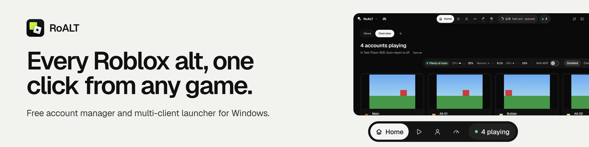
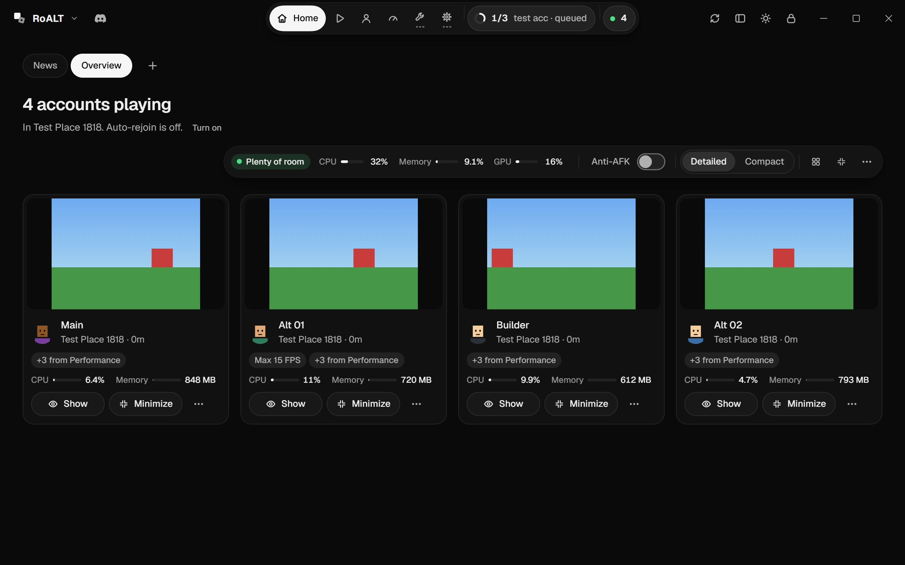
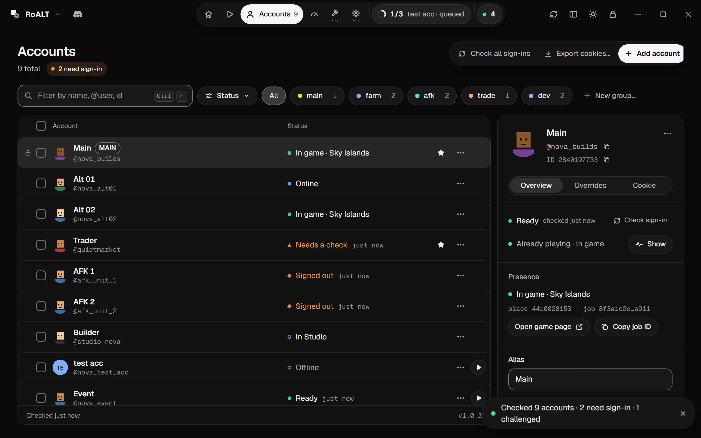
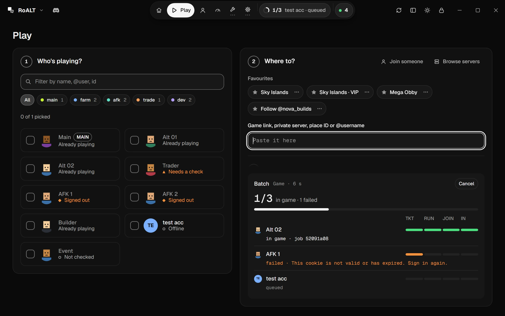
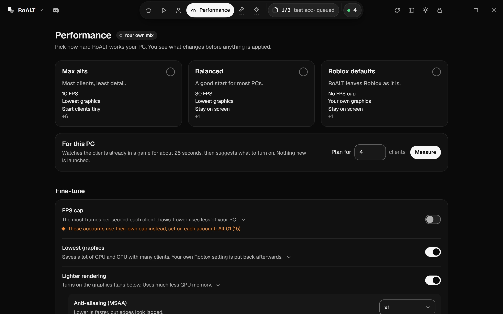
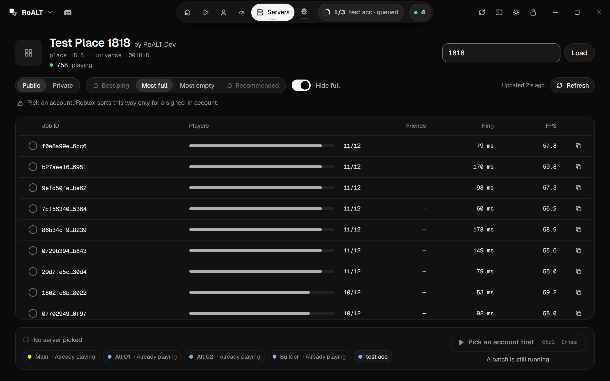
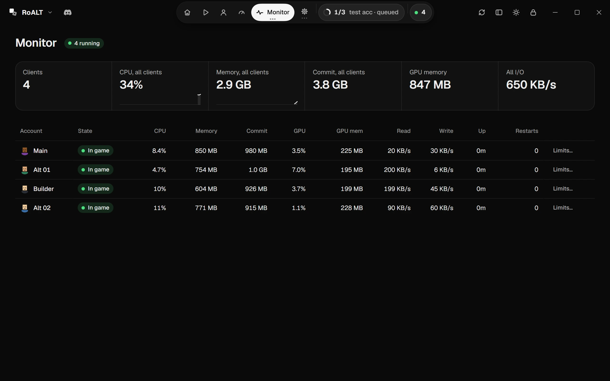
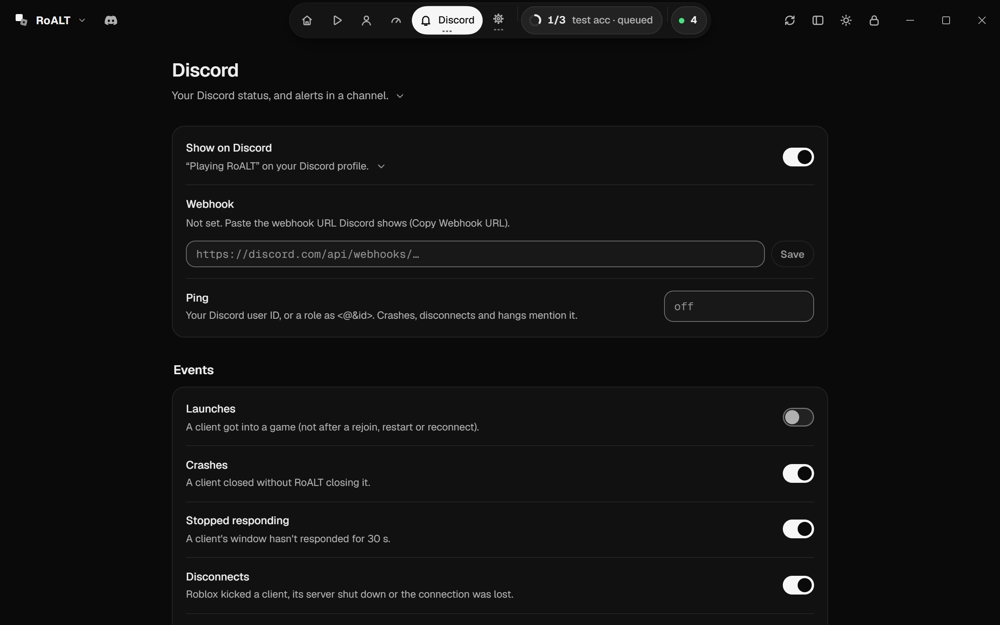
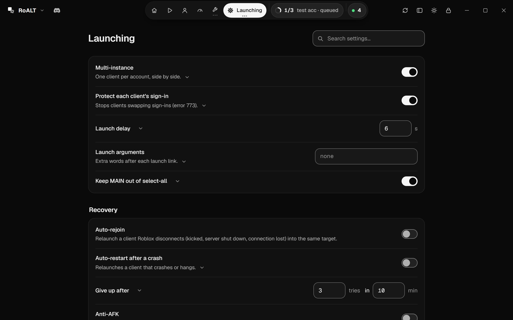
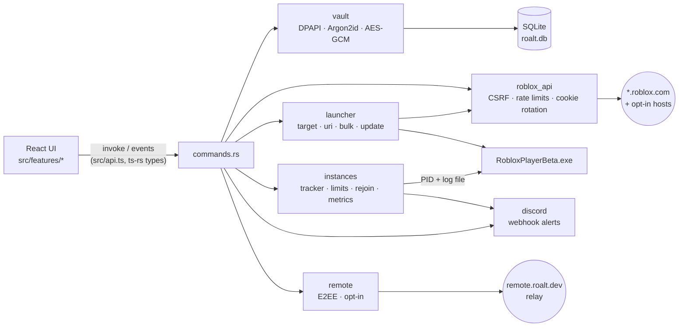

<div align="center">



<br>

A fast, local-only account manager and multi-client launcher for Windows.<br>
Your cookies stay encrypted on your PC and never leave it.

[](https://github.com/inspectsoftware/RoALT/releases/latest)
[](https://github.com/inspectsoftware/RoALT/releases)
[](#-install)
[](https://discord.gg/roaltdev)

[](https://github.com/inspectsoftware/RoALT/actions/workflows/ci.yml)


<br>

[**⬇ Download**](https://github.com/inspectsoftware/RoALT/releases/latest) &nbsp;·&nbsp;
[**💬 Discord**](https://discord.gg/roaltdev) &nbsp;·&nbsp;
[**🌐 Try it in your browser**](https://roalt.dev) &nbsp;·&nbsp;
[Quick start](#-quick-start) &nbsp;·&nbsp;
[Privacy](#-safety-and-privacy) &nbsp;·&nbsp;
[For developers](#-for-developers)

<br>



</div>

<br>

## 📑 Contents

| For everyone | For developers |
|---|---|
| [What is RoALT?](#-what-is-roalt) | [Architecture](#-architecture) |
| [Features](#-features) | [Tech stack](#-tech-stack) |
| [Install](#-install) | [Build from source](#-build-from-source) |
| [Quick start](#-quick-start) | [Project layout](#-project-layout) |
| [Safety and privacy](#-safety-and-privacy) | [Testing](#-testing) |
| [FAQ](#-faq) | [Contributing](#-contributing) |
| [Community](#-community) | [Cut a release](#-cut-a-release) |

<br>

## 💡 What is RoALT?

If you play Roblox on more than one account, you know the routine: sign out, sign in, find the game again,
and only ever one client open at a time. RoALT removes all of that.

- **Add each account once**, through Roblox's own sign-in page. RoALT keeps it signed in.
- **See every account at a glance**: online status, Robux, friends, whether the sign-in still works.
- **Paste any game link** and launch one account, or ten, into it. Even into the same server.
- **Run several Roblox windows side by side**, and let RoALT bring back any that crash or get kicked.

It runs entirely on your PC. There is no RoALT account and no tracking. RoALT has two servers: an online counter that gets a random ID and how many Roblox clients RoALT runs, which you can turn off, and, only if you turn on Remote, a relay that passes encrypted traffic between your PC and your phone. RoALT's site is asked who sponsors and supports it, with nothing sent about you. Rolimons values (off by default) only download Rolimons' public item list.

<table>
<tr>
<td width="50%"><br><sub><b>Accounts:</b> status, groups and details at a glance</sub></td>
<td width="50%"><br><sub><b>Play:</b> who plays, where, and each account's progress</sub></td>
</tr>
<tr>
<td><br><sub><b>Settings › Performance:</b> presets, For this PC and fine-tuning</sub></td>
<td><br><sub><b>Servers:</b> pick a server, send any accounts into it</sub></td>
</tr>
<tr>
<td><br><sub><b>Monitor:</b> what every client uses, every 2 seconds</sub></td>
<td><br><sub><b>Discord:</b> your status, and alerts in your own channel</sub></td>
</tr>
<tr>
<td><br><sub><b>Settings:</b> one page, Areas or Goals, and a search for any setting</sub></td>
<td><br><sub><b>Custom themes:</b> Midnight, or any colours you like</sub></td>
</tr>
</table>

<br>

## ✨ Features

<table>
<tr>
<td width="50%" valign="top">

### 🔐 Encrypted vault
Cookies are encrypted with **Windows DPAPI**, or with your own **master password** (Argon2id + AES-256-GCM)
with auto-lock and an optional **recovery code**. Reveal and copy sit behind **Windows Hello** or the master password.

</td>
<td width="50%" valign="top">

### 👥 Accounts at a glance
Avatars, live presence, Robux, the RAP of each account's limiteds, Plus, friends, followers and 2-step status. Groups, aliases, notes,
favourites, search and filters. Check sign-ins, one or all, in a click. Your **MAIN** account stays out of
select-all, so a batch never takes it by accident.

</td>
</tr>
<tr>
<td valign="top">

### 🚀 Launch anything
Paste a game link, place ID, job ID, private server or share link, a profile or `@username`:
RoALT works out what it is. Join a friend, save a target as a favourite, **Browse games** on roblox.com
inside RoALT and send one to Play, or go back to a server your accounts were in with **Last played**.

</td>
<td valign="top">

### 🪟 Multi-instance
Run several clients side by side. Launch a batch one after another, all into **the same server**
or spread over **different servers** (your own private ones, random or the closest), with live progress per account.

</td>
</tr>
<tr>
<td valign="top">

### 🔁 Auto-rejoin and restart
A disconnected client rejoins the same game on its own. Opt-in: crashed, frozen or memory-hungry
clients restart too. A crash breaker gives up on an account after too many tries.

</td>
<td valign="top">

### 🗺️ Server browser
Browse public servers by players or ping, see your private servers, and send any accounts into
the one you pick. **Details** shows a game's likes, visits, favourites, passes with prices and badges with how rare they are.

</td>
</tr>
<tr>
<td valign="top">

### 📈 Monitor
CPU, memory, disk/network and uptime per client, with sparklines and totals, refreshed every 2 seconds.

</td>
<td valign="top">

### 🎚️ Performance
The first area of Settings. Three presets, **Max alts**, **Balanced** and **Roblox defaults**, and you see every change before it applies.
Each preset shows about how many clients this PC fits, from its processor, memory and graphics card, and the one that
fits all your accounts is marked **Recommended**, before you've launched anything.
**For this PC** watches your running clients for about 25 seconds and suggests what to turn on. FPS cap, lowest graphics and graphics flags (MSAA, textures, no grass, gray sky), with presets and
shareable profiles. **Max alts** runs clients tiny, at 10 FPS, with a CPU share that scales with how many
you run and memory trims. The one you're playing stays free of it. CPU and memory settings have their own
panel, most useful first. Cap one client's CPU, pin cores or trim memory.

</td>
</tr>
<tr>
<td valign="top">

### 🔔 Discord alerts
Crashes, disconnects (with why: kicked, idle, connection lost, server shut down), sign-in problems,
restarts and finished batches posted to **your own** webhook, kept encrypted in the vault. Alerts name
the game, not its place id. Opt-in.

</td>
<td valign="top">

### ⬆️ Roblox updates
Shows when Roblox is out of date and installs the update with Roblox's own installer, after checking
it is signed by Roblox Corporation. Optional auto-update when no client runs.

</td>
</tr>
<tr>
<td valign="top">

### 🖥️ Home
Every running client as a live preview, even hidden ones, in cards you can drag and resize. Click a picture to
bring that client to the front; right-click to minimize, shrink, limit or close it. One bar above them holds
what your PC can take, Anti-AFK, the card size and the window tools. Browser-style **account tabs** give each
account its own game and options. Prefer your accounts in a list? The side layout puts them in a rail.

</td>
<td valign="top">

### 🛡️ Public networks
Windows calls some networks **Public** (café, hotel, school Wi-Fi). Turn off **Allow public networks** in Settings,
Security, and RoALT won't launch on them and a master-password vault locks there. It is on by default.

</td>
</tr>
<tr>
<td valign="top">

### ↔️ Free resizing
Drag a client's edges to any size, past the 800×600 minimum Roblox holds it to, and move small windows
without them snapping back. Or start every client tiny.

</td>
<td valign="top">

### 🏝️ The island
A quiet, near-black window with one living control: the **island**, a pill in the title bar that holds every
section and grows a launch's progress and your running clients out of its side. Light theme too, white by
default or any accent you pick, and motion you can turn down (or up) in Settings.

</td>
</tr>
<tr>
<td valign="top">

### 🌍 18 languages
English, Arabic (fully right to left), Bosnian, Chinese (Simplified), Filipino, French, German, Indonesian,
Japanese, Korean, Polish, Portuguese (Brazil), Russian, Spanish, Swedish, Thai, Turkish and Vietnamese.

</td>
<td valign="top">

### ❤️ Support RoALT
RoALT is free. **Donate**, in the app menu (the RoALT logo) or Settings › About, opens a [Roblox gamepass](https://www.roblox.com/games/102259086923102/Donation-Experience#!/store)
for the amount you pick, and you confirm the purchase on Roblox. No Robux? [Buy me a coffee](https://buymeacoffee.com/roaltdev) works too, from the same
dialog. Monthly supporters there get a Supporter role on [Discord](https://discord.gg/roaltdev) and their name in Settings › About.
Want to sponsor RoALT? News has one clearly marked **Sponsored** card; ask on Discord.

</td>
</tr>
<tr>
<td valign="top">

### 📰 News
RoALT releases, the Roblox DevForum's announcements and release notes, the Roblox Newsroom and Roblox client
updates, in one tab on Home, with unread counts.

</td>
<td valign="top">

### 📤 Cookie export
Export the cookies of the accounts you pick to a `username:cookie` file, for a backup or another tool. It needs your
master password if you set one, and RoALT deletes the file after 10 minutes or when it closes.

</td>
</tr>
<tr>
<td valign="top">

### 🎨 Modpacks
Change Roblox's textures, sounds, fonts, cursors and sky with modpacks you import as a zip, and share them as a zip.
Turn each on or off and drag to order them. Mods made for Bloxstrap work too. Roblox's own folder is never changed,
and a modpack can't carry code.

</td>
<td valign="top">

### 🌈 Custom themes
Recolour the window, title bar, navigation bar, panels, tabs, buttons, menus and text, or start from **Midnight**,
**Sakura**, **Terminal**, **Ocean** or **Paper**. Share a theme as a code, and make corners square or extra round.
Text stays readable whatever you pick.

</td>
</tr>
<tr>
<td valign="top">

### 🖼️ Animated backgrounds
Your own picture or animated GIF behind the app, up to 16 MB, with a choice of how much the theme covers it. A GIF
holds still while RoALT isn't in front, so the clients you're playing don't pay for it.

</td>
<td valign="top">

### 📱 Remote
Off by default. Turn it on and pair your phone with a QR code to watch your clients, their live previews and the
monitor from [remote.roalt.dev](https://remote.roalt.dev/). Give a device **Control** and it can also launch, close
and play. You approve every device on the PC, and it's end-to-end encrypted. [What the relay sees](#-safety-and-privacy).

</td>
</tr>
</table>

<details>
<summary><b>All features, in detail</b></summary>
<br>

| Area | What you get |
|---|---|
| 🔐 **Vault** | DPAPI by default (opens silently). Optional master password with auto-lock after idle, and an optional one-use recovery code for it. Encrypted `.roalt` backups you can export and import: accounts, groups, favourites, and your settings and Discord webhook (restored only when you tick it on import). Copied cookies are kept out of clipboard history and cleared after 30 s. |
| 👥 **Accounts** | Add through Roblox's sign-in page (passkeys and security keys work), by pasting a cookie, by pasting many cookies at once, by pasting `username:password` lines (Roblox's sign-in opens filled in for each; passwords are never saved), or by importing from Roblox Account Manager (an unlocked `AccountData.json`; its groups come along). A new account goes into the group you have open, or the one you pick. Groups, alias, notes, colour, favourite, drag to reorder; the filter box also searches notes, and **Overrides** lists the accounts with settings of their own. A group can carry **defaults** for its accounts (FPS cap, Full quality, launch arguments, Mute Discord, Bring back, and a new client's limits and anti-AFK): an account's own setting wins, then the first group in the list that sets it, then your settings. **Columns** adds Added, Checked, FPS cap, Playtime, Robux and limiteds value to the list; click a heading to sort by it, **My order** goes back to yours. **Edit…** on a selection changes Full quality, Bring back, Mute Discord, the FPS cap, launch arguments or the group of all of them at once. Presence, Robux, Plus / Premium (legacy), friend and follower counts, join date, email and 2-step status. **Limiteds**: count an account's limited items for their total RAP and the most valuable ones (only when you press Count; with opt-in **Rolimons values**, also their value, demand and trend). "Open on roblox.com" opens Browse as that account. **MAIN** stays out of select-all (a setting). **Export cookies** of the accounts you pick as `username:cookie` lines; the file is deleted after 10 minutes or when RoALT closes. |
| 🚀 **Play** | Game links, place IDs, `roblox://` links, job IDs, private server links, `roblox.com/share` links (both formats), universes, profiles, `@username`. Join a friend or one of your other accounts. Favourites on the Play page and in the tray; each keeps its accounts and groups (whoever is in a group when it launches), its server mode and FPS cap, and can have a global key of its own. **Recent** offers the games your accounts played last, and **Last played…** the exact servers they were in (a public one rejoins as it was). **Browse games** opens roblox.com as the first picked account; Play or Join there fills in Play instead of launching. `Ctrl+Enter` to launch. An account that's already playing can be picked too: RoALT asks, then moves its client (into the same game, to the emptiest other server). |
| 🌐 **Browse** | roblox.com inside RoALT, signed in as any account: games, the Marketplace, people search, friends, editing each account's avatar. Play on a game page launches through RoALT (opened from Play's **Browse games**, it fills in Play instead); **Play…** takes the game to the Play page for more accounts, and **Save as favourite** keeps it. **Popular** lists Roblox's charts without the ads; **Limiteds** lists every limited with its RAP, Rolimons value, demand and trend, to search and sort (only with Rolimons values on); **Playtime** shows how long each account spent in each game, and per day for the last 90 days (as bars, and as a CSV file). **Details** on a game (in Popular, Playtime, on a game's page and in Servers) shows its players, visits, favourites, likes, about how many servers run, its age rating, avatar type, places, the owning group's members, passes with their prices and badges with how many players won them. **Player details** on a profile page shows when they joined, where they are now, friends, followers, groups with their role, Roblox badges, the games they made, and their limiteds (RAP, the most valuable, or that the inventory is private). Create isn't there, and **Lock purchases** (on by default) stops spending Robux and buying Robux or Premium while free items still work. |
| 🪟 **Batches** | Accounts launch strictly one after another with a stagger (default 6 s). **Same server**: *Pick a server* finds one with room for everyone first; *Follow the first* sends the rest to wherever the first account landed. **Different servers**: your own private servers, random public ones, the closest, the most full or the most empty; servers your accounts are in, or joined in the last hour, are handed out last. Cancel at any time; one click re-picks the accounts that didn't launch. |
| 🔁 **Recovery** | Auto-rejoin after kicks, shutdowns and lost connections (not after you leave on purpose). Opt-in auto-restart for crashes, frozen windows (30 s) and a memory limit. Crash breaker: default 3 relaunches in 10 minutes, with growing backoff. Per-account "Allow disconnect". Every end is kept in **Crash history** with the log's reason. **Timers** (off by default): restart each client every N hours, since long runs use more and more memory, and close each client once its run has lasted N hours; neither touches a Full quality account's client or the one in front. Limits you set on a running client (CPU limit, efficiency mode, trimming, cores, anti-AFK off) are **kept for that account's next client**, also after a rejoin or restart. |
| ↔️ **Free resizing** | Drag a client's edge to any size, past the minimum Roblox holds its window to, and move a small window by its title bar without it growing back. RoALT sizes the window itself (a mouse hook in RoALT's own process); nothing goes into the client. **Start clients tiny** opens every new client at a size you choose. |
| 🖥️ **Home** | Live preview for every client at 5, 15, 30 or 60 FPS, even hidden ones, with one status pill, game, uptime, CPU and RAM, and only the limits that differ from your defaults. Click a picture to show that client. Drag cards to sort them and resize them from the corner; **Compact** shows only the preview, with its actions on hover or focus. The bar above them says what your PC can take (it opens dials for CPU, memory and GPU), switches Anti-AFK, and holds Tile windows, Minimize all and **⋯** (Restore all, Tile tiny windows, Refresh, Close all). Browser-style **account tabs** give each account its own game and options, and launch one or all of them. **Layout** (Settings or the title bar) moves your accounts to a rail on the side. Drag accounts and sections to sort them, or use `Alt` and the arrow keys; the order is saved, and a launch of all tabs follows it. The **⋯** key, right-click, the menu key or `Shift+F10` for show, minimize, restore, tiny window (any size, 320×240 by default) and back, CPU limit, efficiency mode, anti-AFK, close. Recently closed clients come back with **Play again**, or **Play all again**. |
| 🛑 **Stop all** | Hold one button (in the app menu, or the running clients' sheet in the island), use the tray, or press a global **panic hotkey** you choose (off by default) to end every Roblox process and stop pending launches and rejoins. |
| ⌨️ **Global keys** | Optional keys that work in any app (all unset by default): show or hide RoALT, tile the clients, minimize them all, and one per favourite to launch it. |
| 🌍 **Languages** | English, Arabic (right to left), Bosnian, Chinese (Simplified), Filipino, French, German, Indonesian, Japanese, Korean, Polish, Portuguese (Brazil), Russian, Spanish, Swedish, Thai, Turkish, Vietnamese. |
| ⏲️ **Automation** | Minimize each new client on launch. Auto-shutdown timer: close the clients and shut the PC down at a set time (survives a RoALT restart, can be cancelled). Hourly Roblox log cleaner (logs older than a day or over 50 MB). Open logs button; RoALT's own logs rotate at 5 MB. |
| 🔗 **Default Roblox launcher** | Pick what opens `roblox://` and `roblox-player:` links on this PC: Roblox, a bootstrapper RoALT finds (Bloxstrap, Fishstrap, Froststrap, Voidstrap, or any other holding the links), or RoALT. RoALT launches your accounts through the one picked. With RoALT, Play on roblox.com starts the game at once (multi-instance keeps working) and Roblox links fill in Play so you pick the account. RoALT takes the links back after a Roblox update; uninstalling RoALT gives them back to the program they came from. |
| ⚙️ **Launch control** | Custom launch arguments (default and per account, checked before use and never logged), a cooldown between launches, a configurable close grace (1–60 s). |
| 🎚️ **Limits** | Per client: CPU cap, efficiency mode, core affinity, working-set trim (every N minutes and sooner if a background client grows, or "Page memory out now"). A trim lowers the Memory column for a while; commit size doesn't change. Adaptive manager for background clients; a limit you set on a client wins for that limit. **Memory throttle**: a client whose commit size is over a limit gets a CPU cap, which lowers its frame rate, until it drops under 90 % of the limit. It doesn't free memory; only **Restart on high memory** does, and that disconnects the client. |
| 🎞️ **FPS cap & graphics** | A default frame-rate cap (5–360), a per-account override and a per-launch one under Play's More options (a rejoin keeps it), plus the lowest graphics for every client (on by default). Set through Roblox's own Maximum Frame Rate and Graphics Quality just before each client starts; your own Roblox settings are put back once it has read them, and again when such a client closes (or when RoALT next starts, if it wasn't running then). Everything performance-related lives in **Settings › Performance**. |
| 🪶 **Lighter rendering** | Clients RoALT starts get low geometry detail and the graphics flags below (on by default): less GPU time and memory per client. Written just before each client starts and put back once it has read them; skipped under a bootstrapper. |
| 🎚️ **Graphics flags** | Pick MSAA, texture quality, rendering mode, gray sky, no grass and lowest render quality, from the FastFlags Roblox still allows. Roblox may ignore Vulkan and OpenGL. |
| 🧩 **Custom FFlags** | Add your own FastFlags as a list or paste Bloxstrap's JSON, for every account or each its own. They win over the graphics flags; Roblox applies only the ones on its allowlist. |
| 🎨 **Modpacks** | Import a zip with `content`, `PlatformContent` or `ExtraContent` folders (Bloxstrap's Modifications layout) to change textures, sounds, fonts, cursors, meshes and the sky; export any modpack as a zip to share it. On/off per modpack, drag to order (the top one wins a file two modpacks change). Clients RoALT starts run from its own copy of the Roblox folder (hard links, with the modpacks laid over), so Roblox's folder and launches from outside RoALT stay unmodded. Only images, sounds, fonts, meshes and font lists are taken, each checked by its first bytes; no scripts, models, configs or anything outside those folders. Skipped under a bootstrapper. Windows' per-app GPU choice is kept by the exe's path, so it doesn't follow modded clients. |
| 🧾 **History** | **Crash history** (More tools): the newest 200 ends of your clients, with what its log said and what the end points to (the client crashed, never started, was closed), filters, and CSV export. An account's **History** tab: its Robux in, out and pending over the last month, its newest purchases, sales, group payouts and Premium stipends, and how its clients ended. |
| 👑 **Main account** | Mark an account **Full quality** and its clients keep your own Roblox graphics, without lowest graphics or lighter rendering. |
| 🕘 **Recent servers** | Each account remembers the servers it reached (stored on this PC); rejoin a public one in a click. |
| 🩺 **Diagnostics** | Copy or save a report for bug reports, from Debug: tickets, cookies, your Windows user name and IP addresses are removed. A client that ends badly leaves an autopsy in the log: how long it lived, any crash dump, Windows' record of the fault and the end of its logs. Each trim logs its memory before and after. |
| 📤 **Performance profiles** | Export your performance settings to a file or a share code, or import someone else's: you see what changes, then apply it. Only performance settings travel, never accounts, passwords, launch arguments or hotkeys. |
| 📶 **Bandwidth** | One upload cap for all Roblox clients through a Windows QoS policy. Applied only when you click Apply (admin prompt); cleared when Windows restarts. |
| 💤 **Anti-AFK** | Off by default, with a switch on Home. While you are away from the PC, every few minutes each client is briefly brought to the front and gets one F13 press (no game uses it, so the character stays put), so Roblox doesn't kick it after 20 idle minutes. A minimized client is restored for the press and minimized again. Stops the moment you touch the mouse. Roblox only counts a real key press in the window in front: keys posted to a background window don't stop the idle kick (measured). Per-client opt-out. |
| 🔔 **Discord** | Crash, disconnect, restart and batch alerts, with the game's name and why a client was disconnected. Also when an account's sign-in stops working or Roblox wants a human check, and when a newer RoALT is out. Opt-in alerts when a client gets into a game or is slowed down for its memory, and when the PC's memory or the clients' GPU use stays nearly full. Mute alerts per account. **Rich presence** (on by default, a switch on the Discord page): your profile shows "Playing RoALT", idling or with the game and how many alts run. |
| 📰 **News** | A tab on Home with RoALT's releases (GitHub), the DevForum's announcements and release notes, the Roblox Newsroom and Roblox client updates. Filter by source, unread counts, mark all read. |
| 🔄 **RoALT updates** | Looks for a new RoALT on GitHub Releases at start and every 6 hours (can be turned off; *Check now* in Settings). The island offers it; *Update now* downloads it, checks its release signature, installs it silently and restarts RoALT. Never installs on its own. Older installers stay on GitHub Releases, but they get no fixes or support, and an older RoALT won't open data saved by a newer one (it says so and changes nothing). |
| 📱 **Remote** | Off by default (Settings › Remote). **Pair device** shows a QR code and an 8-character code for [remote.roalt.dev](https://remote.roalt.dev/), valid 120 s; a code pairing also shows a 6-digit code on both screens to compare. Every device needs **Approve** on the PC and starts as **View only**: clients, live previews, the monitor and crashes. **Control** adds launching accounts and favourites, closing, arranging and limiting clients, stopping them all, a shutdown timer, and taps, a joystick, camera drag and keys inside a client. Held keys and touches are let go when the device goes quiet. A title-bar pill shows who is connected; **Revoke** removes a device. Up to 64 devices; one dashboard can follow several PCs. Optional pause on Public networks. While Windows is locked, previews and input stop and management still works. |
| 🧰 **Comfort** | Tray menu with favourites, the window tools (Tile, Minimize all, Restore all), Play all again and the Anti-AFK switch, and a tooltip that counts the running clients; close to tray, relaunch an ended client in one click, movable data folder, keyboard shortcuts (`?` lists them). One search (`Ctrl+F`) finds any setting, in Settings or Discord, and takes you to it. Dark, light or system theme, white by default or any accent colour, and your own background image or animated GIF (it holds still while you play in Roblox), with a choice of how much the theme covers it. **Custom themes**: recolour the window, title bar, navigation bar, panels, tabs, buttons, menus and text, start from a built-in theme (Midnight, Sakura, Terminal, Ocean, Paper), make corners square or round, and share a theme as a code. Text stays readable whatever you pick. **Motion**: follow Windows' animation setting, or always full or reduced. Optional skip of the splash screen. |

</details>

<br>

## 📥 Install

1. Download **`RoALT-Setup-<version>.exe`** from the [latest release](https://github.com/inspectsoftware/RoALT/releases/latest).
2. Run it. No admin rights needed; it installs to `%LOCALAPPDATA%\Programs\RoALT`.
3. Start RoALT from the Start menu or the desktop icon.

| Requirement | |
|---|---|
| Windows | 10 (1809 or later) or 11, x64 |
| WebView2 Runtime | Built into Windows 11. Setup offers to download it when missing. |
| Roblox | Installed normally (RoALT can install or update it for you) |

> [!NOTE]
> The installer isn't code-signed yet, so Windows SmartScreen shows a warning on first run.
> Click **More info → Run anyway** to install.
>
> *(Optional)* To verify the download against `SHA256SUMS.txt` on the release page:
>
> ```powershell
> Get-FileHash .\RoALT-Setup-<version>.exe -Algorithm SHA256
> ```

Your accounts and settings live in `%LOCALAPPDATA%\RoALT`. Uninstalling asks whether to keep them
(a silent uninstall, like winget's, always keeps them). If you moved the data folder in Settings, the
uninstaller leaves that folder alone: delete it yourself.

<br>

## 🏁 Quick start

The first time RoALT starts, a short setup walks you through it: language and look, how your accounts are kept safe, what you'll use RoALT for, and your first account, then an optional tour. Skipped it? Settings › About › **Start again**.

<details open>
<summary><b>1. Add your first account</b></summary>
<br>

Press **Add account** (or `Ctrl+N`). A clean Roblox sign-in window opens: sign in as usual, including 2-step or
passkeys. RoALT keeps the sign-in, closes the window and deletes the sign-in from its browser profile. You can also paste a
`.ROBLOSECURITY` cookie; it is checked before it is saved.

</details>

<details>
<summary><b>2. (Optional) Set a master password</b></summary>
<br>

By default the vault is locked to your Windows account (DPAPI), so it opens silently: another PC or another Windows
account can't open it, though software running as your Windows user can. Windows Hello in this mode confirms
reveal, copy, and export in the UI. For protection against software running on your account while RoALT is locked,
set a master password in **Settings**: RoALT then asks for it on start and locks itself when you're idle or lock Windows.

</details>

<details>
<summary><b>3. Launch a game</b></summary>
<br>

Go to **Play** (`Ctrl+3`), pick an account, paste a Roblox game link (copy the URL from a game page on roblox.com,
or click **Browse games** to pick one directly) and press the big **Play** key (`Ctrl+Enter`).
Pick several accounts to launch a batch. Under **More options**, turn on **Same server** to put them all in one server.

</details>

<details>
<summary><b>4. Run several clients at once</b></summary>
<br>

**Multi-instance** is on by default (the switch is in **Settings → Launching**); start RoALT before Roblox. If Roblox is already open, RoALT says so and offers
**Close Roblox** or **Take over**. Every client RoALT starts shows up on **Home**
(`Ctrl+1`), with its state, server and uptime.

</details>

<details>
<summary><b>5. Let it look after your clients</b></summary>
<br>

In **Settings → Launching**, turn on **Auto-rejoin** (and, if you like, **Auto-restart**). Open **Monitor**
(`Ctrl+6`) to see what each client uses, and **Discord** (`Ctrl+7`) to get alerts on your phone.

</details>

<details>
<summary><b>⌨️ Keyboard shortcuts</b></summary>
<br>

| Keys | Action |
|---|---|
| `Ctrl+1` … `Ctrl+9` | Home, Accounts, Play, Servers, Settings, Monitor, Discord, Debug, Settings › Performance |
| `Ctrl+N` | Add account |
| `Ctrl+F` | Search accounts |
| `Ctrl+Enter` | Play |
| `F5` | Refresh |

</details>

<br>

## 🔒 Safety and privacy

<table>
<tr>
<td width="50%" valign="top">

#### ✅ What RoALT does

- Talks **only** to `*.roblox.com` and `*.rbxcdn.com`, plus GitHub for RoALT updates and for News' list of RoALT releases (each can be turned off; an update downloads from `github.com` and GitHub's `objects.githubusercontent.com` / `release-assets.githubusercontent.com`), RoALT's online counter (`roalt-online.roalt-counterlive.workers.dev`, can be turned off), the Remote relay (`wss://remote.roalt.dev/ws/remote`, only while Remote is on and a device is paired or pairing), `roalt.dev` for the sponsor (can be turned off) and, while Settings › About is open, the supporter names, Rolimons' public item list (only with Rolimons values on), and your Discord webhook. *(Embedded Roblox webviews restrict top-level navigation to Roblox/sign-in hosts; third-party subresources embedded by Roblox's own web pages load as in any browser.)*
- Encrypts every cookie with **AES-256-GCM** under a key protected by **Windows DPAPI** (stops another PC or Windows user, not software running as you), plus your master password if you set one (locks the key whenever RoALT is locked).
- Encrypts the **whole database** too (SQLCipher, AES-256), with its own DPAPI-protected key: a copied `roalt.db` can't be read on another PC or Windows account.
- Signs you in through **Roblox's own page**, in a browser profile of its own that keeps no Roblox, Google or Apple sign-in once the window closes. Besides Roblox, that window opens only Google's and Apple's sign-in pages (`accounts.google.com`, `appleid.apple.com`), when you pick them.
- Installs Roblox updates **only** when the installer is signed by Roblox Corporation.
- Updates itself **only** when you click Update now, and only with an installer that carries RoALT's release signature.
- Redacts launch tickets from anything it reads in Roblox's logs.
- Keeps **Browse** on Roblox: no other site, no Create, no downloads, no pop-up windows. A page's Play link is read for the game only; RoALT launches with its own ticket. With **Lock purchases** on, Browse refuses Robux-spending requests before they leave your PC (in-game purchases happen in the Roblox client, which RoALT can't block).

</td>
<td width="50%" valign="top">

#### 🚫 What RoALT never does

- **Never** reads or writes the Roblox client's memory or files, with two exceptions for the clients it starts: Roblox's own settings file (`GlobalBasicSettings_13.xml`, only the frame-rate cap and graphics quality) and the FFlags in the version folder's `ClientSettings\ClientAppSettings.json` (the allowlisted rendering flags, plus any custom FFlags you add). Both are put back as they were once the client has read them. **Modpacks** never change Roblox's folder: with a modpack on, RoALT starts the client from its own copy in `%LOCALAPPDATA%\RoALT\mods` (hard links to Roblox's files, a modpack's files written as new ones), and only images, sounds, fonts, meshes and font lists go in.
- **Never** sends telemetry beyond the online count: every few minutes (5 now; the counter sets it), a random ID made when RoALT starts and how many Roblox clients RoALT runs, nothing else ([the counter's source](server/online-counter)). Turn it off in **Settings > About** and nothing is sent. There is no RoALT account.
- **Sponsor and supporters.** News can show one card marked **Sponsored**, and Settings › About lists who supports RoALT. Both come from one small
  file, `https://roalt.dev/app.json`, read when News or About opens and then at most every 6 hours; the request carries no ID and nothing about your PC or accounts, only RoALT's
  version in its user agent. The card's link is always RoALT's own page (`roalt.dev/go/sponsor`), never an address from that file, and clicks
  aren't counted by the app. Turn off **Show the sponsor in News** in Settings › About and the file is read only while Settings › About
  is open.
- **Never** writes cookies, tickets or launch arguments to its logs.
- **Never** changes Windows settings, except the opt-in bandwidth limit.
- **Never** contacts Discord's servers unless you paste a webhook. Rich presence goes only to the Discord app on your PC.
- **Never** contacts Rolimons unless you turn on **Rolimons values** (Settings > About). Then it downloads only Rolimons' public item list while counting limiteds or showing Browse › Limiteds, and sends no user ID, name or cookie.
- **Never** sends a cookie, vault password, recovery code, account note or launch argument to a Remote device, even one with Control.

</td>
</tr>
</table>

<details>
<summary><b>The details</b></summary>
<br>

- **Discord rich presence (on by default).** RoALT tells the Discord app on this PC, over its local pipe, the game's
  name and how many clients run. Discord shows that on your profile. Turn it off under **Settings → Show on Discord**.
- **Discord alerts (opt-in).** If you paste a webhook in the Discord tab, alerts go to that webhook on `discord.com`. The URL is
  kept encrypted in the vault, and messages name accounts by display name and username only, with mentions disabled.
  Nothing is sent while the vault is locked.
- **Roblox updates** come from Roblox only: the version from `clientsettingscdn.roblox.com`, the installer from
  `setup.rbxcdn.com`, run only when its signature checks out as Roblox Corporation's.
- **News (on by default)** asks GitHub for RoALT's newest releases, and the Roblox DevForum and Roblox's newsroom for theirs,
  when RoALT starts and every 30 minutes while its window is shown. Turn **News** off in Settings › About and none of them is asked.
- **RoALT updates** are looked up on GitHub (`api.github.com`, this repository's latest published release) as soon
  as RoALT starts and every 6 hours, unless you turn *Check for RoALT updates* off in Settings. The request carries only
  `RoALT/<version>` as its user agent. When you click Update now, the installer and its `.sig` are downloaded from
  `github.com` (GitHub's own download hosts only), and the installer runs only if its ECDSA P-256 signature checks out
  against the public key built into RoALT. The signature covers the version too, so the release must be newer than
  the RoALT you run and the installer must be the one signed for that version. It installs silently, and RoALT starts again.
  Roblox clients keep running through it, and the restarted RoALT follows them again (also after you close and reopen
  RoALT). Their limits are lifted while RoALT is closed and set again when it starts.
- **Multi-instance** works by creating one named Windows object before Roblox starts. RoALT also holds Roblox's shared
  sign-in files while its clients run, so clients can't sign each other out.
- **Limits** go through Windows itself (job objects, priority, affinity). RoALT only ever opens a client with the
  narrow rights a change needs, never to read its memory.
- **Take over (on request)** closes the one "Roblox is already running" lock inside an open Roblox, so RoALT's clients
  can run next to it. It needs to copy that one handle (`PROCESS_DUP_HANDLE`) and never reads or writes the client's memory.
- **Anti-AFK (opt-in)** briefly brings a client to the front and presses F13 the way a keyboard does.
- **Window tools** (previews, hide, micro, tile) use ordinary Windows calls: Windows.Graphics.Capture for previews, and
  `ShowWindow`, `SetWindowPos`, `SetWindowLongPtr` and `SetLayeredWindowAttributes` for the rest. A hidden client gets the
  layered and click-through window styles at alpha 1. Clean exit and panics clear them; if RoALT is killed outright, the
  client stays invisible until RoALT starts again.
- **Free resizing and hidden clients** use a low-level mouse hook and window-event hooks (foreground, Alt-Tab, minimize,
  drags) in RoALT's own process. They see where the mouse is and which window changes across the PC, and store and send
  nothing. A press only acts on the edge or title bar of a client RoALT started; a press on the taskbar or its thumbnails
  is only noted, for a moment, as you asking for a hidden client back.
- **Bandwidth limit (opt-in)** adds a Windows QoS policy named `RoALT-Roblox` through an admin prompt, only when you click
  Apply. Windows drops it on restart. It is the only change RoALT makes to Windows.
- **Limiteds** are counted only when you press Count: RoALT reads that account's inventory on
  `inventory.roblox.com` with the account's own cookie, one page a second, up to 5,000 items. What it holds is kept in
  the encrypted database until you count again.
- **Sign-in watch (on by default).** 90 seconds after RoALT starts and every 6 hours, it asks Roblox who each saved
  sign-in belongs to (`users.roblox.com`, one account at a time), so a dead one is known before a launch finds it. Turn it
  off in **Settings > Security** and sign-ins are checked only when you ask.
- **Share links (`roalt://` / `roalt.dev/play`).** Public games and servers can be copied as a share link that opens
  RoALT directly on Play with that place or server pre-filled (private server codes are never put in share links).
- **Hang watchdog.** A background thread pings RoALT's UI thread every 5 seconds. If the UI stops responding for 30 s
  (outside open menus or window drags), RoALT logs the UI call stack; after 60 s it restarts itself so running Roblox
  clients stay followed (`Tracker::readopt`). In master-password mode the restarted window opens visibly so you can
  unlock it.
- **Remote (opt-in, off by default).** Turned on, RoALT keeps one WebSocket open to RoALT's relay at
  `wss://remote.roalt.dev/ws/remote` while a device is paired or a pairing is open; the dashboard is served from
  `https://remote.roalt.dev/`. What the PC and your devices send each other (clients, previews, commands, input) is
  end-to-end encrypted: P-256 keys made on each side, AES-256-GCM, and a pairing you approve on the PC. The relay
  can't read it, but it does see the IP addresses of your PC and devices, a fixed ID for the PC and its RoALT
  version, when the PC is online, how many devices connect and which PCs a browser follows, and how much traffic
  passes and when. It has no database: rooms and connections live in memory. Relay connections are not in the web
  server's access log. The dashboard page's access log (IP addresses, user agents) rolls over at 10 MB; the old files
  are deleted 72 hours after that, so on a quiet day the current one can hold older lines. The relay's own logs (no
  addresses or IDs) rotate at 3 × 10 MB. On Windows 10, a client a device is watching gets Windows' yellow
  capture border; Windows 11 shows none. Two limits to know: Control can spend Robux and trade in
  game through taps and launches, so give it only to your own devices; and whoever runs the server that serves the
  dashboard could serve changed code to browsers already paired. Never show the QR code or the pairing code on a
  stream or to anyone. More in [the Remote threat model](docs/REMOTE_THREAT_MODEL.md).
- **Rolimons values (opt-in, off by default).** While counting or with Browse › Limiteds open, RoALT downloads Rolimons' public item list from
  `api.rolimons.com` (at most every 30 minutes) with only `RoALT/<version>` as its user agent, and keeps it in the
  database. Nothing about you or your accounts is sent. Rolimons isn't part of Roblox, and its terms don't allow
  automated access without its permission: turning this on is your call.

</details>

> [!IMPORTANT]
> Your `.ROBLOSECURITY` cookie is the key to your account. RoALT keeps it encrypted, but never share a cookie,
> a `.roalt` backup or its password, or a Remote pairing QR code or code, with anyone, including people who say
> they are helping you.

<br>

## ❓ FAQ

<details>
<summary><b>Is RoALT safe to use with my account?</b></summary>
<br>

RoALT signs in the same way the Roblox website does and never modifies the Roblox executable or reads/writes its
memory (for clients it starts, it only writes Roblox's own settings/FFlags files temporarily and puts them back
afterwards). Roblox has said that multi-instance methods which don't modify the client are not affected by its
modified-client enforcement, but it doesn't officially support running several clients at once. Use RoALT only with
accounts you own.

</details>

<details>
<summary><b>Why does Windows warn me when I run the installer?</b></summary>
<br>

The installer isn't code-signed yet, so Windows SmartScreen doesn't recognise it. Click **More info → Run anyway** to
install. *(Optional: you can also check the file's SHA-256 against `SHA256SUMS.txt` on the release page.)*

</details>

<details>
<summary><b>Multi-instance says Roblox is already running.</b></summary>
<br>

Roblox's tray app or an open client already holds the lock RoALT needs. Click **Close Roblox** when RoALT offers it, then
launch from RoALT. To keep that client open, click **Take over** instead.

</details>

<details>
<summary><b>An account shows "Cookie expired" or needs verification.</b></summary>
<br>

Roblox ended that sign-in, or wants a human check. Open the account on roblox.com from its menu and complete the
check, or remove it and add it again.

</details>

<details>
<summary><b>I forgot my master password.</b></summary>
<br>

If you made a **recovery code**, press **Forgot password?** on the unlock screen, enter the code and choose a new
password. The code works once and you get a new one. It's optional: make one when you set the password, or later in
**Settings**.

- A code file on the same PC opens the vault for anyone who finds it, so keep it on a USB stick, a phone or paper.
- It works only for the same Windows user on the same PC. After a Windows reinstall or on a new PC it won't help; a
  `.roalt` backup does.

Without a code the password can't be recovered: that is what makes it safe. Remove the data folder
(`%LOCALAPPDATA%\RoALT`) and add your accounts again, or import a `.roalt` backup whose password you know.

</details>

<details>
<summary><b>Does it work with Bloxstrap?</b></summary>
<br>

Yes. RoALT finds the bootstrappers you have installed; pick one under Settings, Launching, **Default Roblox launcher**
and RoALT launches through it (as `-player`, the way Windows does) and follows its clients. It won't install Roblox updates
over a bootstrapper, since the bootstrapper keeps Roblox up to date itself. RoALT's graphics flags and modpacks are skipped
there, because a bootstrapper writes its own; pick Roblox or RoALT to keep them. Mods made for Bloxstrap's Modifications
folder import into RoALT's Modpacks as they are.

</details>

<details>
<summary><b>Where is my data? Can I move it?</b></summary>
<br>

In `%LOCALAPPDATA%\RoALT`. **Settings → Data** opens it or moves it to another folder or drive.

</details>

<br>

## 💬 Community

Questions, ideas or bug reports? Join the **[Discord server](https://discord.gg/roaltdev)** or
[open an issue](https://github.com/inspectsoftware/RoALT/issues).

<br>

---

<div align="center">

# 🔧 For developers

</div>

## 🧭 Architecture

RoALT is a [Tauri 2](https://tauri.app) app: a Rust backend that owns every secret, process and network call, and a
React UI that talks to it over typed IPC. The UI never sees a cookie unless you reveal one.



| Module | Role |
|---|---|
| [`vault/`](src-tauri/src/vault) | Envelope encryption: one random data key encrypts every secret (AES-256-GCM, row-bound AAD). The key is wrapped with DPAPI, or with an Argon2id key from the master password and then DPAPI. Windows Hello re-auth, `.roalt` backups. |
| [`roblox_api/`](src-tauri/src/roblox_api) | The one typed Roblox client. Every URL in `endpoints.rs`. CSRF from the real request's 403, per-route queues driven by `x-ratelimit-*`, rotated `.ROBLOSECURITY` saved atomically, three error-body shapes parsed. |
| [`launcher/`](src-tauri/src/launcher) | `target.rs` parses any pasted link locally; `uri.rs` builds the `roblox-player:` URI exactly like the website; `bulk.rs` runs batches and same-server; `client_settings.rs` the FPS cap and lowest graphics; `flags.rs` the rendering flags; `update.rs` + `authenticode.rs` install Roblox updates after `WinVerifyTrust`. |
| [`instances/`](src-tauri/src/instances) | `tracker.rs` ties each client to its account by PID, start time and log file; `logwatch.rs` reads job IDs and disconnects; `rejoin.rs` and the crash breaker; `limits.rs` CPU caps, affinity, efficiency mode, trims; `metrics.rs`; `multi.rs` the singleton lock and take-over; `capture.rs` live previews; `window.rs` hidden clients, micro and tile; `resize.rs` free resizing; `qos.rs`; `afk.rs`. |
| [`discord.rs`](src-tauri/src/discord.rs) | Webhook alerts: host-checked URL, events coalesced every 2 s, `retry_after` honoured. |
| [`webview.rs`](src-tauri/src/webview.rs) | The sign-in window and the hardening every Roblox page gets: kept WebView2 profiles with the cookie put in before the first load and deleted after, navigation kept on Roblox (and, in the sign-in window, Google's and Apple's sign-in pages). |
| [`browse.rs`](src-tauri/src/browse.rs) | Browse: roblox.com as a child webview inside the RoALT window, one account at a time; Play links handed to the launcher, the purchase lock, rotated cookies kept. |
| [`rolimons.rs`](src-tauri/src/rolimons.rs) | Rolimons values (opt-in): its public item list, downloaded while counting limiteds or for Browse › Limiteds, at most every 30 minutes, parsed and kept. |
| [`mods/`](src-tauri/src/mods) | Modpacks. `pack.rs` what a modpack may hold (paths, file types by their first bytes) and its zip; `library.rs` the imported ones; `runtime.rs` RoALT's own copy of the version folder that modded clients start from, never pruned while a client runs from it. |
| [`remote/`](src-tauri/src/remote) | Remote: `crypto.rs` pairing and session crypto (P-256, HKDF, AES-GCM); `protocol.rs` the wire types; `dispatch.rs` the allowlist of what a device may do, by role; `preview.rs` preview JPEGs; `mod.rs` the relay connection and pairing. Input goes through `instances/remote_input.rs`. The dashboard is [`web/remote/`](web/remote), the relay [`server/remote-relay/`](server/remote-relay). |
| [`storage/`](src-tauri/src/storage) | SQLite through `rusqlite` with numbered migrations. Running clients live in memory only. |

<details>
<summary><b>How a launch works</b></summary>
<br>

1. Validate the account, then resolve a share link or universe with **that account's** cookie.
2. `GET auth.roblox.com/v1/client-assertion/`, then POST `authentication-ticket` with it, as the website does.
3. Build the `roblox-player:` URI with a fresh `browsertrackerid`, then start the default launcher if it is a bootstrapper
   (`HKCU\Software\Classes\roblox-player\shell\open\command`), else the client from the path in
   `HKCU\Software\ROBLOX Corporation\Environments\roblox-player`.
4. Record the PID and creation time and close the process handle at once.
5. Bind the client's `_Player_` log by that tracker ID, then read its job ID, user ID and disconnects. If Roblox
   relaunches itself during an update, the tracker re-binds through the log's `userid:`.

</details>

<details>
<summary><b>Process-handle rules</b></summary>
<br>

Every sample or change opens a short-lived handle checked against the client's start time, with only the right it
needs: `PROCESS_QUERY_LIMITED_INFORMATION` for metrics, `PROCESS_SET_QUOTA` for trims, `PROCESS_SET_INFORMATION` for
affinity and efficiency mode. Never `PROCESS_VM_READ`; `PROCESS_DUP_HANDLE` only for a take-over you start. Only the
CPU-cap job handle is kept.

</details>

<br>

## 🧱 Tech stack

| Layer | Tools |
|---|---|
| Shell | Tauri 2.12, WebView2 |
| Backend | Rust (edition 2024), tokio, reqwest (rustls), rusqlite + rusqlite_migration, `windows` 0.62, zip (modpacks) |
| Crypto | aes-gcm, argon2, zeroize, Windows DPAPI and Windows Hello |
| Frontend | React 19, TypeScript, Vite, Tailwind CSS 4, TanStack Query 5 |
| IPC types | [ts-rs](https://github.com/Aleph-Alpha/ts-rs): Rust types exported to `src/bindings/` |
| Installer | Inno Setup 6.6, GitHub Actions (CI, and a release on every push to `main`) |

<br>

## 🔨 Build from source

**Needs:** Node.js 24, Rust (stable, with the Visual Studio Build Tools' C++ workload) and, for the installer,
[Inno Setup 6.6 or newer](https://jrsoftware.org/isdl.php).

```powershell
git clone https://github.com/inspectsoftware/RoALT.git
cd RoALT
npm ci
npm run tauri dev        # run the app with hot reload
```

| Command | What it does |
|---|---|
| `npm run tauri dev` | Runs the full app. |
| `npm run dev` | Runs the UI alone in a browser, against a built-in mock of the backend (`src/dev/mockIpc.ts`). |
| `npm run build` | Type-checks and builds the UI into `dist/`. |
| `npm run bindings` | Regenerates the TypeScript types in `src/bindings/` from the Rust types. Run it after changing a `#[ts(export)]` type. |
| `powershell -ExecutionPolicy Bypass -File scripts\build-installer.ps1` | Release build plus installer: `dist-installer\RoALT-Setup-<version>.exe` and its SHA-256. |
| `…\build-installer.ps1 -Dev` | Also keeps `installers\RoALT-Setup-<version>-dev-<stamp>.exe`, one per change. |
| `…\build-installer.ps1 -Qa` | The QA team's build, `installers\RoALT-Setup-<version>-qa-<stamp>.exe`: as `-Dev`, and the first-run setup replays every time RoALT starts. |

> [!TIP]
> Set `ROALT_DATA_DIR` to a scratch folder to run a build without touching your real accounts.

<br>

## 📁 Project layout

```text
├─ src/                    React UI
│  ├─ App.tsx              root: vault, title bar, events
│  ├─ app/                 shell, island model, navigation, theme, live activities, app menu
│  ├─ api.ts               one typed wrapper per backend command
│  ├─ bindings/            ts-rs generated types (committed)
│  ├─ dev/                 mock backend for `npm run dev`, and the ?gallery of every primitive
│  ├─ styles/              tokens and layered CSS
│  ├─ ui/                  shared components, the island, motion
│  └─ features/            dashboard · news · accounts · launch · servers · browse · performance · monitor · discord · mods · crashes · debug · settings · onboarding · splash · vault · donate · remote
├─ src-tauri/              Rust backend
│  ├─ src/
│  │  ├─ main.rs           builder, plugins, managed state
│  │  ├─ commands.rs       IPC layer
│  │  ├─ model.rs          shared types (exported to TS)
│  │  ├─ vault/  roblox_api/  launcher/  instances/  mods/  remote/  storage/
│  │  ├─ browse.rs  discord.rs  news.rs  online.rs  rolimons.rs  rpc.rs  session.rs  watchdog.rs  webview.rs  tray.rs  error.rs
│  └─ tauri.conf.json
├─ web/remote/             Remote dashboard (remote.roalt.dev), deployed apart from the app
├─ server/                 online-counter/ (Cloudflare Worker) · remote-relay/ (Remote's relay, Docker)
├─ installer/RoALT.iss     Inno Setup script
├─ scripts/                build-installer.ps1 · check-i18n.mjs · test-*.mjs
├─ docs/                   images/ · research/fixtures/ (recorded Roblox responses the tests read, no real cookies)
└─ .github/workflows/      ci.yml · release.yml · winget.yml
```

<br>

## 🧪 Testing

```powershell
npm run typecheck                              # TypeScript
npm run i18n:check                             # every language has every text
npm run test:sounds; npm run test:news; npm run test:liquid; npm run test:look
cd src-tauri
cargo test --locked                            # Rust unit tests
cargo clippy --all-targets --locked -- -D warnings
cd ..
npm --prefix web/remote ci; npm --prefix web/remote test; npm --prefix web/remote run build   # Remote dashboard
cargo test --locked --manifest-path server/remote-relay/Cargo.toml                           # Remote relay
```

The Rust tests cover link parsing, URI building (byte-for-byte against the website's output), vault and backup
round-trips, Remote's crypto, and response parsing from recorded fixtures. They never use real cookies. The
dashboard's tests check its WebCrypto against vectors from the Rust side. CI runs all of the above for every push
and pull request: the app on `windows-latest`, the dashboard and the relay on `ubuntu-latest`.

<br>

## 🤝 Contributing

Bug reports, ideas and pull requests are welcome.

1. Open an [issue](https://github.com/inspectsoftware/RoALT/issues) or ask on [Discord](https://discord.gg/roaltdev) first for anything big.
2. Keep changes small and focused, and match the surrounding code.
3. Run the [tests](#-testing) and `npm run bindings` if you changed a shared type.
4. Never commit a real cookie, ticket or webhook, including in fixtures or screenshots.

<br>

## 📦 Cut a release

<details>
<summary><b>Steps</b></summary>
<br>

Every push to `main` that changes the app is published by the Release workflow as the next patch
(the latest release's `X.Y.Z+1`), with its `CHANGELOG.md` section, or else the commits since the last
release, as its notes. Installed copies are offered it within 6 hours. There is no draft to check
first: only push what is ready. A push that changes only docs, `web/` or `server/` publishes nothing:
the Remote dashboard and relay are deployed by hand, and the release still runs their tests.

For a minor or major version:

1. Set the same version in `src-tauri/tauri.conf.json`, `package.json` and `src-tauri/Cargo.toml`,
   then run `cargo update -p roalt --offline` in `src-tauri` so `Cargo.lock` matches (CI builds `--locked`).
2. Commit all four files and push to `main`. That push publishes it.

To roll back, push a revert commit. A run of a commit older than the latest release is refused.

</details>

<br>

## ⚖️ License

[MIT](LICENSE). The license covers the code, not the RoALT name or logo; see [NOTICE](NOTICE.md) before you fork or reuse it.

<br>

## 📜 Disclaimer

RoALT is an independent project, not affiliated with or endorsed by Roblox Corporation. Use it only
with accounts you own. Roblox doesn't officially support running several clients at once and may
change how its client behaves at any time.

<div align="center">
<br>
<sub>Made for people with too many alts. &nbsp;·&nbsp; <a href="https://discord.gg/roaltdev">Discord</a> &nbsp;·&nbsp; <a href="https://github.com/inspectsoftware/RoALT/releases/latest">Download</a> &nbsp;·&nbsp; <a href="https://buymeacoffee.com/roaltdev">Buy me a coffee</a></sub>
</div>
