<div align="center">

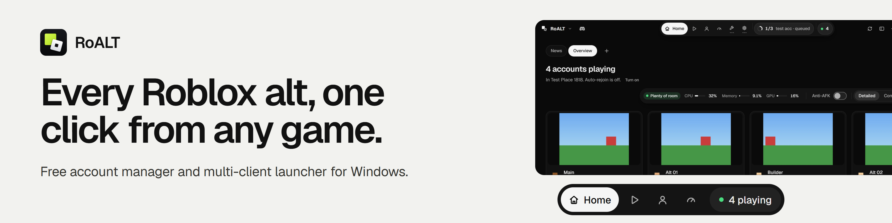

<br>

A fast, local-only account manager and multi-client launcher for Windows.<br>
Your cookies stay encrypted on your PC. Nothing is sent anywhere except Roblox.

[](https://github.com/inspectsoftware/RoALT/releases/latest)
[](https://github.com/inspectsoftware/RoALT/releases)
[](#-install)
[](https://discord.gg/roaltdev)

[](https://github.com/inspectsoftware/RoALT/actions/workflows/ci.yml)


<br>

[**⬇ Download**](https://github.com/inspectsoftware/RoALT/releases/latest) &nbsp;·&nbsp;
[**💬 Discord**](https://discord.gg/roaltdev) &nbsp;·&nbsp;
[**🌐 Try it in your browser**](https://roalt.dev) &nbsp;·&nbsp;
[Quick start](#-quick-start) &nbsp;·&nbsp;
[Privacy](#-safety-and-privacy) &nbsp;·&nbsp;
[For developers](#-for-developers)

<br>

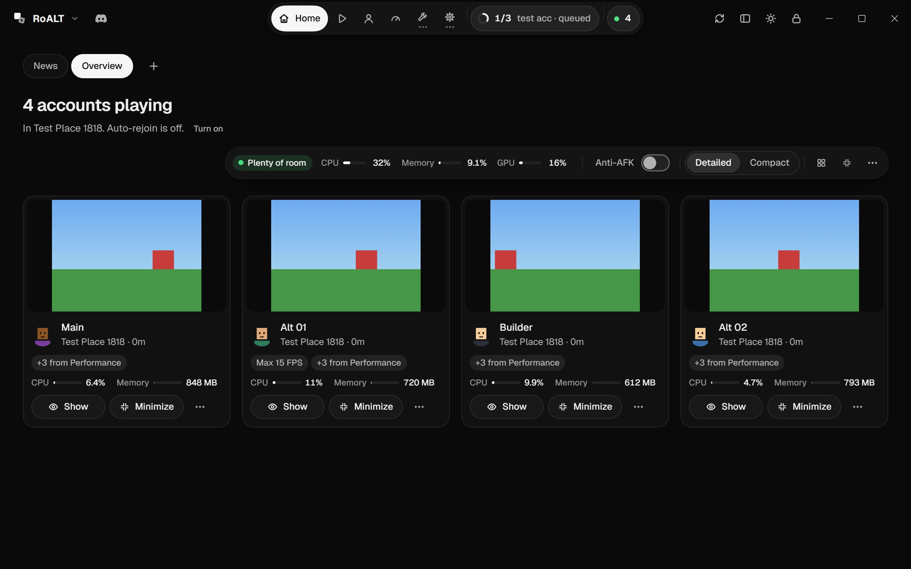

</div>

<br>

## 📑 Contents

| For everyone | For developers |
|---|---|
| [What is RoALT?](#-what-is-roalt) | [Architecture](#-architecture) |
| [Features](#-features) | [Tech stack](#-tech-stack) |
| [Install](#-install) | [Build from source](#-build-from-source) |
| [Quick start](#-quick-start) | [Project layout](#-project-layout) |
| [Safety and privacy](#-safety-and-privacy) | [Testing](#-testing) |
| [FAQ](#-faq) | [Contributing](#-contributing) |
| [Community](#-community) | [Cut a release](#-cut-a-release) |

<br>

## 💡 What is RoALT?

If you play Roblox on more than one account, you know the routine: sign out, sign in, find the game again,
and only ever one client open at a time. RoALT removes all of that.

- **Add each account once**, through Roblox's own sign-in page. RoALT keeps it signed in.
- **See every account at a glance**: online status, Robux, friends, whether the sign-in still works.
- **Paste any game link** and launch one account, or ten, into it. Even into the same server.
- **Run several Roblox windows side by side**, and let RoALT bring back any that crash or get kicked.

It runs entirely on your PC. There is no RoALT account and no tracking: the only RoALT server is an online counter that gets a random ID and how many Roblox clients RoALT runs, and you can turn it off. Rolimons values (off by default) only download Rolimons' public item list.

<table>
<tr>
<td width="50%">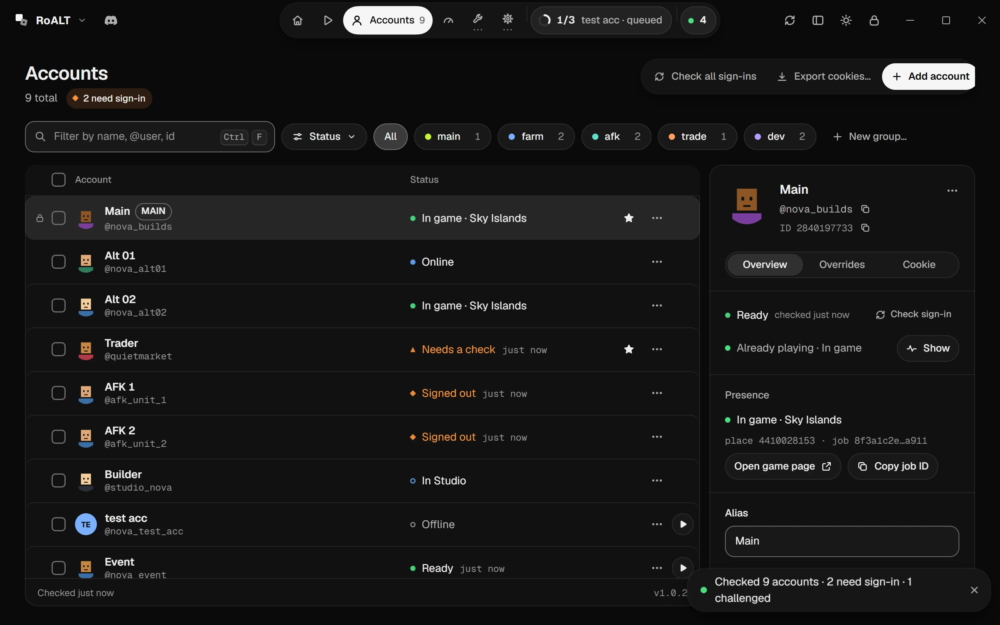<br><sub><b>Accounts:</b> status, groups and details at a glance</sub></td>
<td width="50%">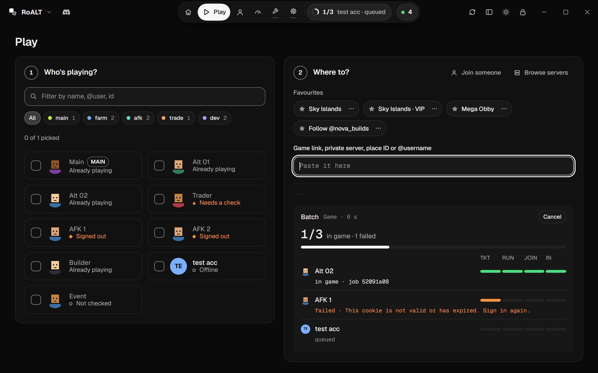<br><sub><b>Play:</b> who plays, where, and each account's progress</sub></td>
</tr>
<tr>
<td>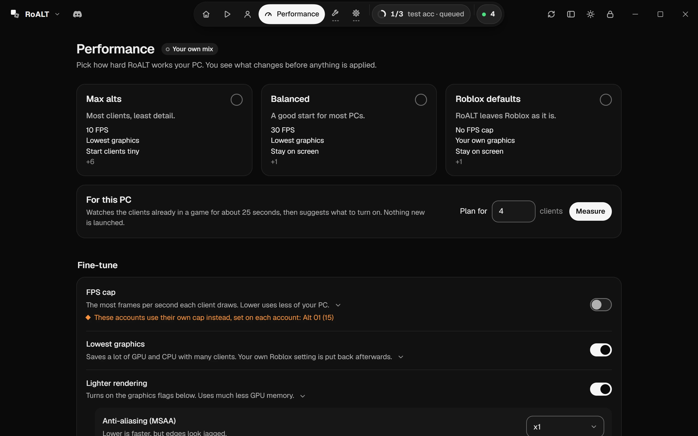<br><sub><b>Performance:</b> presets, For this PC and fine-tuning</sub></td>
<td>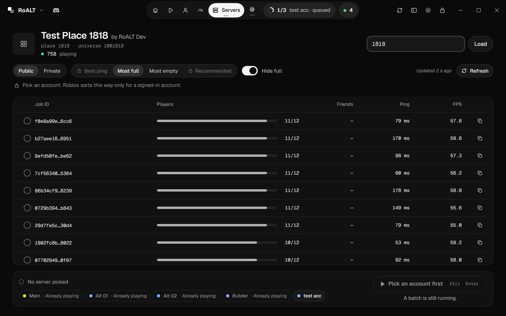<br><sub><b>Servers:</b> pick a server, send any accounts into it</sub></td>
</tr>
<tr>
<td>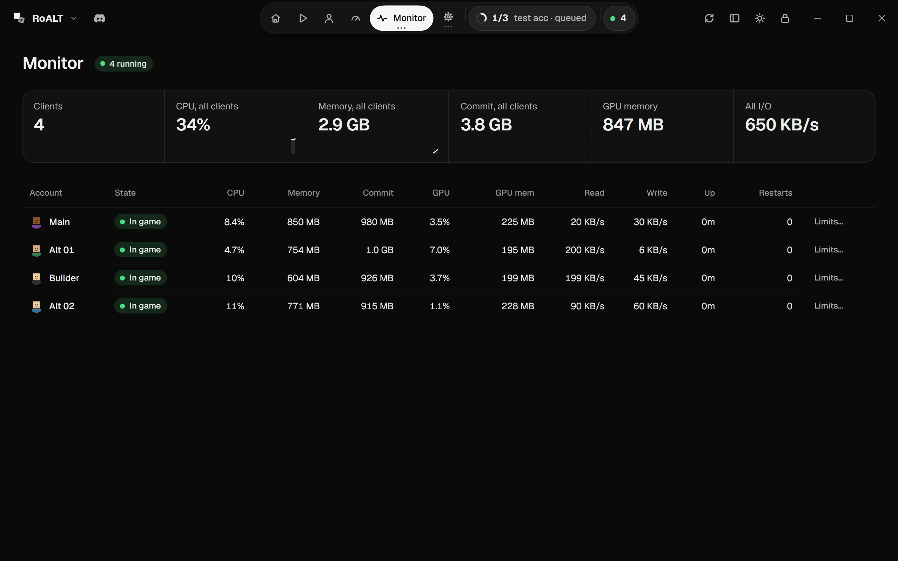<br><sub><b>Monitor:</b> what every client uses, every 2 seconds</sub></td>
<td>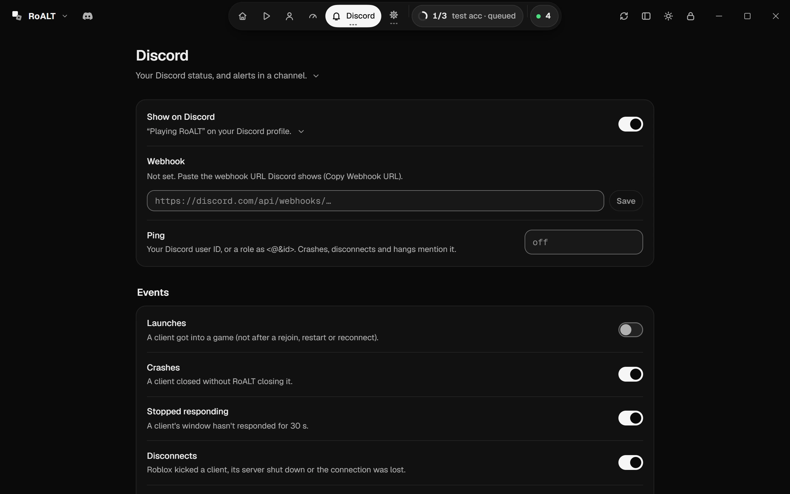<br><sub><b>Discord:</b> your status, and alerts in your own channel</sub></td>
</tr>
<tr>
<td>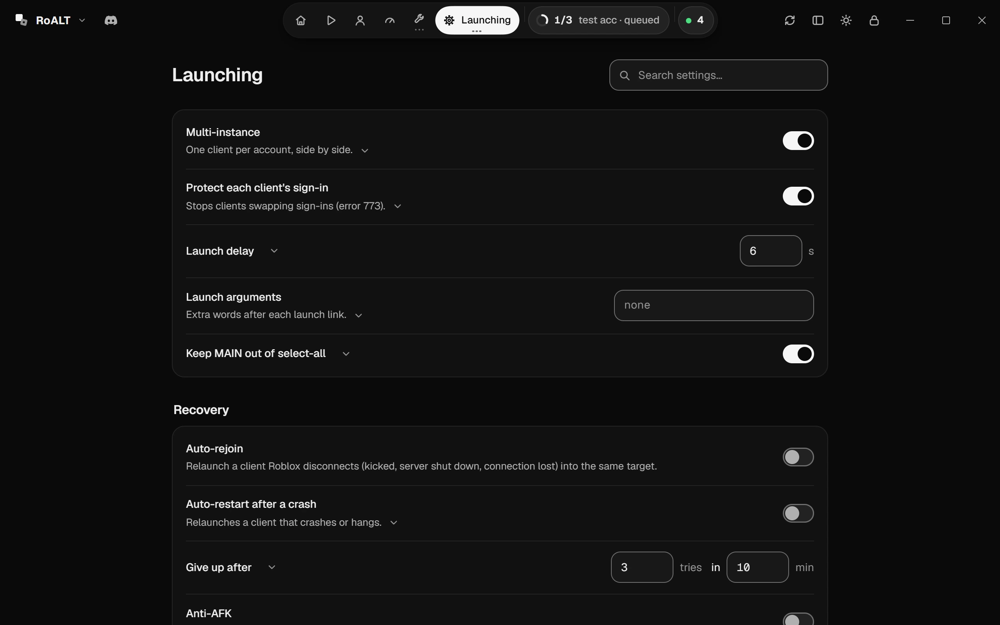<br><sub><b>Settings:</b> launching, recovery, and a search for any setting</sub></td>
<td>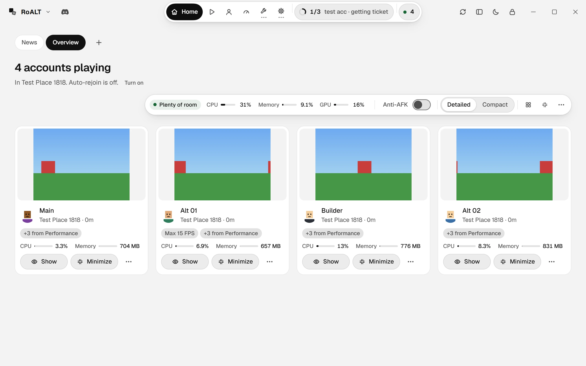<br><sub><b>Light theme:</b> or dark, or follow Windows, with any accent</sub></td>
</tr>
</table>

<br>

## ✨ Features

<table>
<tr>
<td width="50%" valign="top">

### 🔐 Encrypted vault
Cookies are encrypted with **Windows DPAPI**, or with your own **master password** (Argon2id + AES-256-GCM)
with auto-lock and an optional **recovery code**. Reveal and copy sit behind **Windows Hello** or the master password.

</td>
<td width="50%" valign="top">

### 👥 Accounts at a glance
Avatars, live presence, Robux, the RAP of each account's limiteds, Plus, friends, followers and 2-step status. Groups, aliases, notes,
favourites, search and filters. Check sign-ins, one or all, in a click. Your **MAIN** account stays out of
select-all, so a batch never takes it by accident.

</td>
</tr>
<tr>
<td valign="top">

### 🚀 Launch anything
Paste a game link, place ID, job ID, private server or share link, a profile or `@username`:
RoALT works out what it is. Join a friend, or save a target as a favourite.

</td>
<td valign="top">

### 🪟 Multi-instance
Run several clients side by side. Launch a batch one after another, all into **the same server**
or spread over **different servers** (your own private ones, random or the closest), with live progress per account.

</td>
</tr>
<tr>
<td valign="top">

### 🔁 Auto-rejoin and restart
A disconnected client rejoins the same game on its own. Opt-in: crashed, frozen or memory-hungry
clients restart too. A crash breaker gives up on an account after too many tries.

</td>
<td valign="top">

### 🗺️ Server browser
Browse public servers by players or ping, see your private servers, and send any accounts into
the one you pick. **Details** shows a game's likes, visits, favourites, passes with prices and badges with how rare they are.

</td>
</tr>
<tr>
<td valign="top">

### 📈 Monitor
CPU, memory, disk/network and uptime per client, with sparklines and totals, refreshed every 2 seconds.

</td>
<td valign="top">

### 🎚️ Performance tab
Three presets, **Max alts**, **Balanced** and **Roblox defaults**, and you see every change before it applies.
**For this PC** watches your running clients for about 25 seconds and suggests what to turn on. FPS cap, lowest graphics and graphics flags (MSAA, textures, no grass, gray sky), with presets and
shareable profiles. **Max alts** runs clients tiny, at 10 FPS, with a CPU share that scales with how many
you run and memory trims. The one you're playing stays free of it. CPU and memory settings have their own
panel, most useful first. Cap one client's CPU, pin cores or trim memory.

</td>
</tr>
<tr>
<td valign="top">

### 🔔 Discord alerts
Crashes, disconnects, restarts and finished batches posted to **your own** webhook, kept encrypted
in the vault. Opt-in.

</td>
<td valign="top">

### ⬆️ Roblox updates
Shows when Roblox is out of date and installs the update with Roblox's own installer, after checking
it is signed by Roblox Corporation. Optional auto-update when no client runs.

</td>
</tr>
<tr>
<td valign="top">

### 🖥️ Home
Every running client as a live preview, even hidden ones, in cards you can drag and resize. Click a picture to
bring that client to the front; right-click to minimize, shrink, limit or close it. One bar above them holds
what your PC can take, Anti-AFK, the card size and the window tools. Browser-style **account tabs** give each
account its own game and options. Prefer your accounts in a list? The side layout puts them in a rail.

</td>
<td valign="top">

### 🛡️ Public networks
Windows calls some networks **Public** (café, hotel, school Wi-Fi). Turn off **Allow public networks** in Settings,
Security, and RoALT won't launch on them and a master-password vault locks there. It is on by default.

</td>
</tr>
<tr>
<td valign="top">

### ↔️ Free resizing
Drag a client's edges to any size, past the 800×600 minimum Roblox holds it to, and move small windows
without them snapping back. Or start every client tiny.

</td>
<td valign="top">

### 🏝️ The island
A quiet, near-black window with one living control: the **island**, a pill in the title bar that holds every
section and grows a launch's progress and your running clients out of its side. Light theme too, white by
default or any accent you pick, your own background, and motion you can turn down (or up) in Settings.

</td>
</tr>
<tr>
<td valign="top">

### 🌍 18 languages
English, Arabic (fully right to left), Bosnian, Chinese (Simplified), Filipino, French, German, Indonesian,
Japanese, Korean, Polish, Portuguese (Brazil), Russian, Spanish, Swedish, Thai, Turkish and Vietnamese.

</td>
<td valign="top">

### ❤️ Support RoALT
RoALT is free. **Donate**, in the app menu (the RoALT logo) or Settings › About, opens a [Roblox gamepass](https://www.roblox.com/games/102259086923102/Donation-Experience#!/store)
for the amount you pick, and you confirm the purchase on Roblox.

</td>
</tr>
<tr>
<td valign="top">

### 📰 News
RoALT releases, the Roblox DevForum's announcements and release notes, the Roblox Newsroom and Roblox client
updates, in one tab on Home, with unread counts.

</td>
<td valign="top">

### 📤 Cookie export
Export the cookies of the accounts you pick to a `username:cookie` file, for a backup or another tool. It needs your
master password if you set one, and RoALT deletes the file after 10 minutes.

</td>
</tr>
</table>

<details>
<summary><b>All features, in detail</b></summary>
<br>

| Area | What you get |
|---|---|
| 🔐 **Vault** | DPAPI by default (opens silently). Optional master password with auto-lock after idle, and an optional one-use recovery code for it. Encrypted `.roalt` backups you can export and import. Copied cookies are kept out of clipboard history and cleared after 30 s. |
| 👥 **Accounts** | Add through Roblox's sign-in page (passkeys and security keys work), by pasting a cookie, by pasting many cookies at once, by pasting `username:password` lines (Roblox's sign-in opens filled in for each; passwords are never saved), or by importing from Roblox Account Manager (an unlocked `AccountData.json`). Groups, alias, notes, colour, favourite, drag to reorder. Presence, Robux, Plus / Premium (legacy), friend and follower counts, join date, email and 2-step status. **Limiteds**: count an account's limited items for their total RAP and the most valuable ones, or every account's at once from Home (only when you press Count; with opt-in **Rolimons values**, also their value, demand and trend). "Open on roblox.com" opens Browse as that account. **MAIN** stays out of select-all (a setting). **Export cookies** of the accounts you pick as `username:cookie` lines; the file is deleted after 10 minutes. |
| 🚀 **Play** | Game links, place IDs, `roblox://` links, job IDs, private server links, `roblox.com/share` links (both formats), universes, profiles, `@username`. Join a friend or one of your other accounts. Favourites on the Play page and in the tray. `Ctrl+Enter` to launch. An account that's already playing can be picked too: RoALT asks, then moves its client (into the same game, to the emptiest other server). |
| 🌐 **Browse** | roblox.com inside RoALT, signed in as any account: games, the Marketplace, people search, friends, editing each account's avatar. Play on a game page launches through RoALT. **Popular** lists Roblox's charts without the ads; **Playtime** shows how long each account spent in each game. **Details** on a game (in Popular, Playtime, on a game's page and in Servers) shows its players, visits, favourites, likes, about how many servers run, its age rating, avatar type, places, the owning group's members, passes with their prices and badges with how many players won them. **Player details** on a profile page shows when they joined, where they are now, friends, followers, groups with their role, Roblox badges, the games they made, and their limiteds (RAP, the most valuable, or that the inventory is private). Create isn't there, and **Lock purchases** (on by default) stops spending Robux and buying Robux or Premium while free items still work. |
| 🪟 **Batches** | Accounts launch strictly one after another with a stagger (default 6 s). **Same server**: *Pick a server* finds one with room for everyone first; *Follow the first* sends the rest to wherever the first account landed. **Different servers**: your own private servers, random public ones, the closest, the most full or the most empty. Cancel at any time; one click re-picks the accounts that didn't launch. |
| 🔁 **Recovery** | Auto-rejoin after kicks, shutdowns and lost connections (not after you leave on purpose). Opt-in auto-restart for crashes, frozen windows (30 s) and a memory limit. Crash breaker: default 3 relaunches in 10 minutes, with growing backoff. Per-account "Allow disconnect". Crash history with the log's reason. |
| ↔️ **Free resizing** | Drag a client's edge to any size, past the minimum Roblox holds its window to, and move a small window by its title bar without it growing back. RoALT sizes the window itself (a mouse hook in RoALT's own process); nothing goes into the client. **Start clients tiny** opens every new client at a size you choose. |
| 🖥️ **Home** | Live preview for every client at 5, 15, 30 or 60 FPS, even hidden ones, with one status pill, game, uptime, CPU and RAM, and only the limits that differ from your defaults. Click a picture to show that client. Drag cards to sort them and resize them from the corner; **Compact** shows only the preview, with its actions on hover or focus. The bar above them says what your PC can take (it opens dials for CPU, memory and GPU), switches Anti-AFK, and holds Tile windows, Minimize all and **⋯** (Restore all, Tile tiny windows, Refresh, Close all). Browser-style **account tabs** give each account its own game and options, and launch one or all of them. **Layout** (Settings or the title bar) moves your accounts to a rail on the side. Drag accounts and sections to sort them, or use `Alt` and the arrow keys; the order is saved, and a launch of all tabs follows it. The **⋯** key, right-click, the menu key or `Shift+F10` for show, minimize, restore, tiny window (any size, 320×240 by default) and back, CPU limit, efficiency mode, anti-AFK, close. Recently closed clients come back with **Play again**, or **Play all again**. |
| 🛑 **Stop all** | Hold one button (in the app menu, or the running clients' sheet in the island), use the tray, or press a global **panic hotkey** you choose (off by default) to end every Roblox process and stop pending launches and rejoins. |
| 🌍 **Languages** | English, Arabic (right to left), Bosnian, Chinese (Simplified), Filipino, French, German, Indonesian, Japanese, Korean, Polish, Portuguese (Brazil), Russian, Spanish, Swedish, Thai, Turkish, Vietnamese. |
| ⏲️ **Automation** | Minimize each new client on launch. Auto-shutdown timer: close the clients and shut the PC down at a set time (survives a RoALT restart, can be cancelled). Hourly Roblox log cleaner (logs older than a day or over 50 MB). Open logs button; RoALT's own logs rotate at 5 MB. |
| ⚙️ **Launch control** | Custom launch arguments (default and per account, checked before use and never logged), a cooldown between launches, a configurable close grace (1–60 s). |
| 🎚️ **Limits** | Per client: CPU cap, efficiency mode, core affinity, working-set trim (every N minutes and sooner if a background client grows, or "Page memory out now"). A trim lowers the Memory column for a while; commit size doesn't change. Adaptive manager for background clients; a limit you set on a client wins for that limit. **Memory throttle**: a client whose commit size is over a limit gets a CPU cap, which lowers its frame rate, until it drops under 90 % of the limit. It doesn't free memory; only **Restart on high memory** does, and that disconnects the client. |
| 🎞️ **FPS cap & graphics** | A default frame-rate cap (5–360), a per-account override and a per-launch one under Play's More options (a rejoin keeps it), plus the lowest graphics for every client (on by default). Set through Roblox's own Maximum Frame Rate and Graphics Quality just before each client starts; your own Roblox settings are put back once it has read them, and again when such a client closes (or when RoALT next starts, if it wasn't running then). Everything performance-related lives in its own **Performance** tab. |
| 🪶 **Lighter rendering** | Clients RoALT starts get low geometry detail and the graphics flags below (on by default): less GPU time and memory per client. Written just before each client starts and put back once it has read them; skipped under a bootstrapper. |
| 🎚️ **Graphics flags** | Pick MSAA, texture quality, rendering mode, gray sky, no grass and lowest render quality, from the FastFlags Roblox still allows. Roblox may ignore Vulkan and OpenGL. |
| 🧩 **Custom FFlags** | Add your own FastFlags as a list or paste Bloxstrap's JSON, for every account or each its own. They win over the graphics flags; Roblox applies only the ones on its allowlist. |
| 👑 **Main account** | Mark an account **Full quality** and its clients keep your own Roblox graphics, without lowest graphics or lighter rendering. |
| 🕘 **Recent servers** | Each account remembers the servers it reached (stored on this PC); rejoin a public one in a click. |
| 🩺 **Diagnostics** | Copy or save a report for bug reports, from Debug: tickets, cookies, your Windows user name and IP addresses are removed. A client that ends badly leaves an autopsy in the log: how long it lived, any crash dump, Windows' record of the fault and the end of its logs. Each trim logs its memory before and after. |
| 📤 **Performance profiles** | Export your performance settings to a file or a share code, or import someone else's: you see what changes, then apply it. Only performance settings travel, never accounts, passwords, launch arguments or hotkeys. |
| 📶 **Bandwidth** | One upload cap for all Roblox clients through a Windows QoS policy. Applied only when you click Apply (admin prompt); cleared when Windows restarts. |
| 💤 **Anti-AFK** | Off by default, with a switch on Home. While you are away from the PC, every few minutes each client is briefly brought to the front and gets one F13 press (no game uses it, so the character stays put), so Roblox doesn't kick it after 20 idle minutes. A minimized client is restored for the press and minimized again. Stops the moment you touch the mouse. Roblox only counts a real key press in the window in front: keys posted to a background window don't stop the idle kick (measured). Per-client opt-out. |
| 🔔 **Discord** | Crash, disconnect, restart and batch alerts, plus an opt-in alert when a client gets into a game. Mute alerts per account. **Rich presence** (on by default, a switch on the Discord page): your profile shows "Playing RoALT", idling or with the game and how many alts run. |
| 📰 **News** | A tab on Home with RoALT's releases (GitHub), the DevForum's announcements and release notes, the Roblox Newsroom and Roblox client updates. Filter by source, unread counts, mark all read. |
| 🔄 **RoALT updates** | Looks for a new RoALT on GitHub Releases at start and every 6 hours (can be turned off; *Check now* in Settings). The island offers it; *Update now* downloads it, checks its release signature, installs it silently and restarts RoALT. Never installs on its own. |
| 🧰 **Comfort** | Tray menu with favourites, close to tray, relaunch an ended client in one click, movable data folder, keyboard shortcuts (`?` lists them). One search (`Ctrl+F`) finds any setting, in Settings, Performance or Discord, and takes you to it. Dark, light or system theme, white by default or any accent colour, and your own background image, with a choice of how much the theme covers it. **Motion**: follow Windows' animation setting, or always full or reduced. Optional skip of the splash screen. |

</details>

<br>

## 📥 Install

1. Download **`RoALT-Setup-<version>.exe`** from the [latest release](https://github.com/inspectsoftware/RoALT/releases/latest).
2. Run it. No admin rights needed; it installs to `%LOCALAPPDATA%\Programs\RoALT`.
3. Start RoALT from the Start menu or the desktop icon.

| Requirement | |
|---|---|
| Windows | 10 (1809 or later) or 11, x64 |
| WebView2 Runtime | Built into Windows 11. Setup offers to download it when missing. |
| Roblox | Installed normally (RoALT can install or update it for you) |

> [!NOTE]
> The installer isn't code-signed yet, so Windows SmartScreen warns on first run. To be sure the file is genuine,
> compare its SHA-256 with `SHA256SUMS.txt` on the release page, then choose **More info → Run anyway**.
>
> ```powershell
> Get-FileHash .\RoALT-Setup-1.1.0.exe -Algorithm SHA256
> ```

Your accounts and settings live in `%LOCALAPPDATA%\RoALT`. Uninstalling keeps them unless you tick
**"also delete my data"**.

<br>

## 🏁 Quick start

<details open>
<summary><b>1. Add your first account</b></summary>
<br>

Press **Add account** (or `Ctrl+N`). A clean Roblox sign-in window opens: sign in as usual, including 2-step or
passkeys. RoALT keeps the sign-in, closes the window and throws its browser profile away. You can also paste a
`.ROBLOSECURITY` cookie; it is checked before it is saved.

</details>

<details>
<summary><b>2. (Optional) Set a master password</b></summary>
<br>

By default the vault is locked to your Windows account, so it opens silently. For extra protection, set a master
password in **Settings**. RoALT then asks for it on start and locks itself after you've been idle.

</details>

<details>
<summary><b>3. Launch a game</b></summary>
<br>

Go to **Play** (`Ctrl+3`), pick an account, paste a game link and press the big **Play** key (`Ctrl+Enter`).
Pick several accounts to launch a batch. Under **More options**, turn on **Same server** to put them all in one server.

</details>

<details>
<summary><b>4. Run several clients at once</b></summary>
<br>

**Multi-instance** is on by default (the switch is in **Settings → Launching**); start RoALT before Roblox. If Roblox is already open, RoALT says so and offers
**Close Roblox** or **Take over**. Every client RoALT starts shows up on **Home**
(`Ctrl+1`), with its state, server and uptime.

</details>

<details>
<summary><b>5. Let it look after your clients</b></summary>
<br>

In **Settings → Launching**, turn on **Auto-rejoin** (and, if you like, **Auto-restart**). Open **Monitor**
(`Ctrl+6`) to see what each client uses, and **Discord** (`Ctrl+7`) to get alerts on your phone.

</details>

<details>
<summary><b>⌨️ Keyboard shortcuts</b></summary>
<br>

| Keys | Action |
|---|---|
| `Ctrl+1` … `Ctrl+9` | Home, Accounts, Play, Servers, Settings, Monitor, Discord, Debug, Performance |
| `Ctrl+N` | Add account |
| `Ctrl+F` | Search accounts |
| `Ctrl+Enter` | Play |
| `F5` | Refresh |

</details>

<br>

## 🔒 Safety and privacy

<table>
<tr>
<td width="50%" valign="top">

#### ✅ What RoALT does

- Talks **only** to `*.roblox.com` and `*.rbxcdn.com`, plus GitHub to look for RoALT updates (can be turned off), RoALT's online counter (can be turned off), Rolimons' public item list (only with Rolimons values on), and your Discord webhook.
- Encrypts every cookie with **AES-256-GCM** under a key protected by **Windows DPAPI**, plus your master password if you set one.
- Encrypts the **whole database** too (SQLCipher, AES-256), with its own DPAPI-protected key: a copied `roalt.db` can't be read on another PC or Windows account.
- Signs you in through **Roblox's own page**, in a throw-away browser profile.
- Installs Roblox updates **only** when the installer is signed by Roblox Corporation.
- Updates itself **only** when you click Update now, and only with an installer that carries RoALT's release signature.
- Redacts launch tickets from anything it reads in Roblox's logs.
- Keeps **Browse** on Roblox: no other site, no Create, no downloads, no pop-up windows. A page's Play link is read for the game only; RoALT launches with its own ticket. With **Lock purchases** on, Browse refuses Robux-spending requests before they leave your PC (in-game purchases happen in the Roblox client, which RoALT can't block).

</td>
<td width="50%" valign="top">

#### 🚫 What RoALT never does

- **Never** reads or writes the Roblox client's memory or files, with two exceptions for the clients it starts: Roblox's own settings file (`GlobalBasicSettings_13.xml`, only the frame-rate cap and graphics quality) and the FFlags in the version folder's `ClientSettings\ClientAppSettings.json` (the allowlisted rendering flags, plus any custom FFlags you add). Both are put back as they were once the client has read them.
- **Never** sends telemetry beyond the online count: every 2 minutes, a random ID made when RoALT starts and how many Roblox clients RoALT runs, nothing else ([the counter's source](server/online-counter)). Turn it off in **Settings > About** and nothing is sent. There is no RoALT account.
- **Never** writes cookies, tickets or launch arguments to its logs.
- **Never** changes Windows settings, except the opt-in bandwidth limit.
- **Never** contacts Discord's servers unless you paste a webhook. Rich presence goes only to the Discord app on your PC.
- **Never** contacts Rolimons unless you turn on **Rolimons values** (Settings > About). Then it downloads only Rolimons' public item list while counting limiteds, and sends no user ID, name or cookie.

</td>
</tr>
</table>

<details>
<summary><b>The details</b></summary>
<br>

- **Discord rich presence (on by default).** RoALT tells the Discord app on this PC, over its local pipe, the game's
  name and how many clients run. Discord shows that on your profile. Turn it off under **Settings → Show on Discord**.
- **Discord alerts (opt-in).** If you paste a webhook in the Discord tab, alerts go to that webhook on `discord.com`. The URL is
  kept encrypted in the vault, and messages name accounts by display name and username only, with mentions disabled.
  Nothing is sent while the vault is locked.
- **Roblox updates** come from Roblox only: the version from `clientsettingscdn.roblox.com`, the installer from
  `setup.rbxcdn.com`, run only when its signature checks out as Roblox Corporation's.
- **RoALT updates** are looked up on GitHub (`api.github.com`, this repository's latest published release) as soon
  as RoALT starts and every 6 hours, unless you turn *Check for RoALT updates* off in Settings. The request carries only
  `RoALT/<version>` as its user agent. When you click Update now, the installer and its `.sig` are downloaded from
  `github.com` (GitHub's own download hosts only), and the installer runs only if its ECDSA P-256 signature checks out
  against the public key built into RoALT. The signature covers the version too, so the release must be newer than
  the RoALT you run and the installer must be the one signed for that version. It installs silently, and RoALT starts again.
  Roblox clients keep running through it, and the restarted RoALT follows them again (also after you close and reopen
  RoALT). Their limits are lifted while RoALT is closed and set again when it starts.
- **Multi-instance** works by creating one named Windows object before Roblox starts. RoALT also holds Roblox's shared
  sign-in files while its clients run, so clients can't sign each other out.
- **Limits** go through Windows itself (job objects, priority, affinity). RoALT only ever opens a client with the
  narrow rights a change needs, never to read its memory.
- **Take over (on request)** closes the one "Roblox is already running" lock inside an open Roblox, so RoALT's clients
  can run next to it. It needs to copy that one handle (`PROCESS_DUP_HANDLE`) and never reads or writes the client's memory.
- **Anti-AFK (opt-in)** briefly brings a client to the front and presses F13 the way a keyboard does.
- **Window tools** (previews, hide, micro, tile) use ordinary Windows calls: Windows.Graphics.Capture for previews, and
  `ShowWindow`, `SetWindowPos`, `SetWindowLongPtr` and `SetLayeredWindowAttributes` for the rest. A hidden client gets the
  layered and click-through window styles at alpha 1. Clean exit and panics clear them; if RoALT is killed outright, the
  client stays invisible until RoALT starts again.
- **Free resizing and hidden clients** use a low-level mouse hook and window-event hooks (foreground, Alt-Tab, minimize,
  drags) in RoALT's own process. They see where the mouse is and which window changes across the PC, and store and send
  nothing. A press only acts on the edge or title bar of a client RoALT started; a press on the taskbar or its thumbnails
  is only noted, for a moment, as you asking for a hidden client back.
- **Bandwidth limit (opt-in)** adds a Windows QoS policy named `RoALT-Roblox` through an admin prompt, only when you click
  Apply. Windows drops it on restart. It is the only change RoALT makes to Windows.
- **Limiteds** are counted only when you press Count (or Count all on Home): RoALT reads that account's inventory on
  `inventory.roblox.com` with the account's own cookie, one page a second, up to 5,000 items. What it holds is kept in
  the encrypted database until you count again.
- **Rolimons values (opt-in, off by default).** While counting, RoALT downloads Rolimons' public item list from
  `api.rolimons.com` (at most every 30 minutes) with only `RoALT/<version>` as its user agent, and keeps it in the
  database. Nothing about you or your accounts is sent. Rolimons isn't part of Roblox, and its terms don't allow
  automated access without its permission: turning this on is your call.

</details>

> [!IMPORTANT]
> Your `.ROBLOSECURITY` cookie is the key to your account. RoALT keeps it encrypted, but never share a cookie,
> a `.roalt` backup or its password with anyone, including people who say they are helping you.

<br>

## ❓ FAQ

<details>
<summary><b>Is RoALT safe to use with my account?</b></summary>
<br>

RoALT signs in the same way the Roblox website does and never touches the Roblox client. Roblox has said that
multi-instance methods which don't modify the client are not affected by its modified-client enforcement, but it
doesn't officially support running several clients at once. Use RoALT only with accounts you own.

</details>

<details>
<summary><b>Why does Windows warn me when I run the installer?</b></summary>
<br>

The installer isn't code-signed yet, so SmartScreen doesn't recognise it. Check the SHA-256 against
`SHA256SUMS.txt` on the release, then choose **More info → Run anyway**.

</details>

<details>
<summary><b>Multi-instance says Roblox is already running.</b></summary>
<br>

Roblox's tray app or an open client already holds the lock RoALT needs. Click **Close Roblox** when RoALT offers it, then
launch from RoALT. To keep that client open, click **Take over** instead.

</details>

<details>
<summary><b>An account shows "Cookie expired" or needs verification.</b></summary>
<br>

Roblox ended that sign-in, or wants a human check. Open the account on roblox.com from its menu and complete the
check, or remove it and add it again.

</details>

<details>
<summary><b>I forgot my master password.</b></summary>
<br>

If you made a **recovery code**, press **Forgot password?** on the unlock screen, enter the code and choose a new
password. The code works once and you get a new one. It's optional: make one when you set the password, or later in
**Settings**.

- A code file on the same PC opens the vault for anyone who finds it, so keep it on a USB stick, a phone or paper.
- It works only for the same Windows user on the same PC. After a Windows reinstall or on a new PC it won't help; a
  `.roalt` backup does.

Without a code the password can't be recovered: that is what makes it safe. Remove the data folder
(`%LOCALAPPDATA%\RoALT`) and add your accounts again, or import a `.roalt` backup whose password you know.

</details>

<details>
<summary><b>Does it work with Bloxstrap?</b></summary>
<br>

Yes. RoALT launches through the registered bootstrapper and follows its clients. It won't install Roblox updates over a
bootstrapper, since the bootstrapper keeps Roblox up to date itself. RoALT's graphics flags are skipped there, because a
bootstrapper writes its own.

</details>

<details>
<summary><b>Where is my data? Can I move it?</b></summary>
<br>

In `%LOCALAPPDATA%\RoALT`. **Settings → Data** opens it or moves it to another folder or drive.

</details>

<br>

## 💬 Community

Questions, ideas or bug reports? Join the **[Discord server](https://discord.gg/roaltdev)** or
[open an issue](https://github.com/inspectsoftware/RoALT/issues).

<br>

---

<div align="center">

# 🔧 For developers

</div>

## 🧭 Architecture

RoALT is a [Tauri 2](https://tauri.app) app: a Rust backend that owns every secret, process and network call, and a
React UI that talks to it over typed IPC. The UI never sees a cookie unless you reveal one.

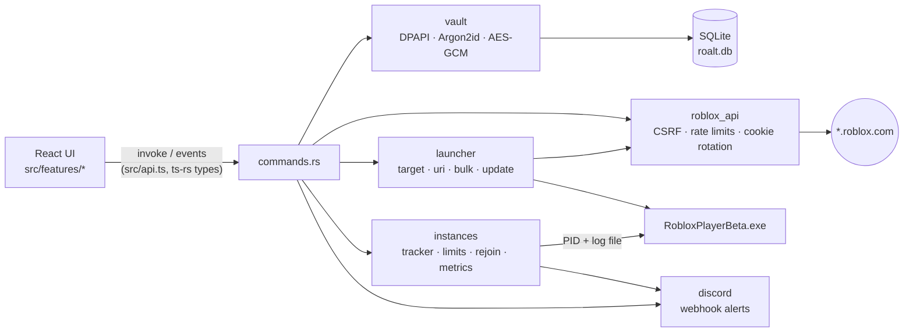

| Module | Role |
|---|---|
| [`vault/`](src-tauri/src/vault) | Envelope encryption: one random data key encrypts every secret (AES-256-GCM, row-bound AAD). The key is wrapped with DPAPI, or with an Argon2id key from the master password and then DPAPI. Windows Hello re-auth, `.roalt` backups. |
| [`roblox_api/`](src-tauri/src/roblox_api) | The one typed Roblox client. Every URL in `endpoints.rs`. CSRF from the real request's 403, per-route queues driven by `x-ratelimit-*`, rotated `.ROBLOSECURITY` saved atomically, three error-body shapes parsed. |
| [`launcher/`](src-tauri/src/launcher) | `target.rs` parses any pasted link locally; `uri.rs` builds the `roblox-player:` URI exactly like the website; `bulk.rs` runs batches and same-server; `client_settings.rs` the FPS cap and lowest graphics; `flags.rs` the rendering flags; `update.rs` + `authenticode.rs` install Roblox updates after `WinVerifyTrust`. |
| [`instances/`](src-tauri/src/instances) | `tracker.rs` ties each client to its account by PID, start time and log file; `logwatch.rs` reads job IDs and disconnects; `rejoin.rs` and the crash breaker; `limits.rs` CPU caps, affinity, efficiency mode, trims; `metrics.rs`; `multi.rs` the singleton lock and take-over; `capture.rs` live previews; `window.rs` hidden clients, micro and tile; `resize.rs` free resizing; `qos.rs`; `afk.rs`. |
| [`discord.rs`](src-tauri/src/discord.rs) | Webhook alerts: host-checked URL, events coalesced every 2 s, `retry_after` honoured. |
| [`webview.rs`](src-tauri/src/webview.rs) | The sign-in window and the hardening every Roblox page gets: kept WebView2 profiles with the cookie put in before the first load and deleted after, navigation kept on Roblox. |
| [`browse.rs`](src-tauri/src/browse.rs) | Browse: roblox.com as a child webview inside the RoALT window, one account at a time; Play links handed to the launcher, the purchase lock, rotated cookies kept. |
| [`rolimons.rs`](src-tauri/src/rolimons.rs) | Rolimons values (opt-in): its public item list, downloaded while counting limiteds at most every 30 minutes, parsed and kept. |
| [`storage/`](src-tauri/src/storage) | SQLite through `rusqlite` with numbered migrations. Running clients live in memory only. |

<details>
<summary><b>How a launch works</b></summary>
<br>

1. Validate the account, then resolve a share link or universe with **that account's** cookie.
2. `GET auth.roblox.com/v1/client-assertion/`, then POST `authentication-ticket` with it, as the website does.
3. Build the `roblox-player:` URI with a fresh `browsertrackerid`, then start the client from the path in
   `HKCU\Software\ROBLOX Corporation\Environments\roblox-player`.
4. Record the PID and creation time and close the process handle at once.
5. Bind the client's `_Player_` log by that tracker ID, then read its job ID, user ID and disconnects. If Roblox
   relaunches itself during an update, the tracker re-binds through the log's `userid:`.

</details>

<details>
<summary><b>Process-handle rules</b></summary>
<br>

Every sample or change opens a short-lived handle checked against the client's start time, with only the right it
needs: `PROCESS_QUERY_LIMITED_INFORMATION` for metrics, `PROCESS_SET_QUOTA` for trims, `PROCESS_SET_INFORMATION` for
affinity and efficiency mode. Never `PROCESS_VM_READ`; `PROCESS_DUP_HANDLE` only for a take-over you start. Only the
CPU-cap job handle is kept.

</details>

<br>

## 🧱 Tech stack

| Layer | Tools |
|---|---|
| Shell | Tauri 2.12, WebView2 |
| Backend | Rust (edition 2024), tokio, reqwest (rustls), rusqlite + rusqlite_migration, `windows` 0.62 |
| Crypto | aes-gcm, argon2, zeroize, Windows DPAPI and Windows Hello |
| Frontend | React 19, TypeScript, Vite, Tailwind CSS 4, TanStack Query 5 |
| IPC types | [ts-rs](https://github.com/Aleph-Alpha/ts-rs): Rust types exported to `src/bindings/` |
| Installer | Inno Setup 6.6, GitHub Actions (CI and tagged draft releases) |

<br>

## 🔨 Build from source

**Needs:** Node.js 24, Rust (stable, with the Visual Studio Build Tools' C++ workload) and, for the installer,
[Inno Setup 6.6 or newer](https://jrsoftware.org/isdl.php).

```powershell
git clone https://github.com/inspectsoftware/RoALT.git
cd RoALT
npm ci
npm run tauri dev        # run the app with hot reload
```

| Command | What it does |
|---|---|
| `npm run tauri dev` | Runs the full app. |
| `npm run dev` | Runs the UI alone in a browser, against a built-in mock of the backend (`src/dev/mockIpc.ts`). |
| `npm run build` | Type-checks and builds the UI into `dist/`. |
| `npm run bindings` | Regenerates the TypeScript types in `src/bindings/` from the Rust types. Run it after changing a `#[ts(export)]` type. |
| `powershell -ExecutionPolicy Bypass -File scripts\build-installer.ps1` | Release build plus installer: `dist-installer\RoALT-Setup-<version>.exe` and its SHA-256. |
| `…\build-installer.ps1 -Dev` | Also keeps `installers\RoALT-Setup-<version>-dev-<stamp>.exe`, one per change. |

> [!TIP]
> Set `ROALT_DATA_DIR` to a scratch folder to run a build without touching your real accounts.

<br>

## 📁 Project layout

```text
├─ src/                    React UI
│  ├─ App.tsx              root: vault, title bar, events
│  ├─ app/                 shell, island model, navigation, theme, live activities, app menu
│  ├─ api.ts               one typed wrapper per backend command
│  ├─ bindings/            ts-rs generated types (committed)
│  ├─ dev/                 mock backend for `npm run dev`, and the ?gallery of every primitive
│  ├─ styles/              tokens and layered CSS
│  ├─ ui/                  shared components, the island, motion
│  └─ features/            dashboard · news · accounts · launch · servers · performance · monitor · discord · debug · settings · splash · vault · donate
├─ src-tauri/              Rust backend
│  ├─ src/
│  │  ├─ main.rs           builder, plugins, managed state
│  │  ├─ commands.rs       IPC layer
│  │  ├─ model.rs          shared types (exported to TS)
│  │  ├─ vault/  roblox_api/  launcher/  instances/  storage/
│  │  ├─ discord.rs  webview.rs  tray.rs  error.rs
│  └─ tauri.conf.json
├─ installer/RoALT.iss     Inno Setup script
├─ scripts/                build-installer.ps1
├─ docs/                   images/ · research/fixtures/ (recorded Roblox responses the tests read, no real cookies)
└─ .github/workflows/      ci.yml · release.yml
```

<br>

## 🧪 Testing

```powershell
npm run typecheck                              # TypeScript
cd src-tauri
cargo test --locked                            # Rust unit tests
cargo clippy --all-targets --locked -- -D warnings
```

The Rust tests cover link parsing, URI building (byte-for-byte against the website's output), vault and backup
round-trips, and response parsing from recorded fixtures. They never use real cookies. CI runs all of the above on
`windows-latest` for every push and pull request.

<br>

## 🤝 Contributing

Bug reports, ideas and pull requests are welcome.

1. Open an [issue](https://github.com/inspectsoftware/RoALT/issues) or ask on [Discord](https://discord.gg/roaltdev) first for anything big.
2. Keep changes small and focused, and match the surrounding code.
3. Run the [tests](#-testing) and `npm run bindings` if you changed a shared type.
4. Never commit a real cookie, ticket or webhook, including in fixtures or screenshots.

<br>

## 📦 Cut a release

<details>
<summary><b>Steps</b></summary>
<br>

1. Set the same version in `src-tauri/tauri.conf.json`, `package.json` and `src-tauri/Cargo.toml`,
   then run `cargo update -p roalt --offline` in `src-tauri` so `Cargo.lock` matches (CI builds `--locked`).
2. Commit all four files, then tag and push the tag: `git tag vX.Y.Z && git push origin vX.Y.Z`.
3. The Release workflow builds the installer and puts it with `SHA256SUMS.txt` on a draft release.
   Check it, then publish the draft.

</details>

<br>

## ⚖️ License

[MIT](LICENSE). The license covers the code, not the RoALT name or logo; see [NOTICE](NOTICE.md) before you fork or reuse it.

<br>

## 📜 Disclaimer

RoALT is an independent project, not affiliated with or endorsed by Roblox Corporation. Use it only
with accounts you own. Roblox doesn't officially support running several clients at once and may
change how its client behaves at any time.

<div align="center">
<br>
<sub>Made for people with too many alts. &nbsp;·&nbsp; <a href="https://discord.gg/roaltdev">Discord</a> &nbsp;·&nbsp; <a href="https://github.com/inspectsoftware/RoALT/releases/latest">Download</a></sub>
</div>
